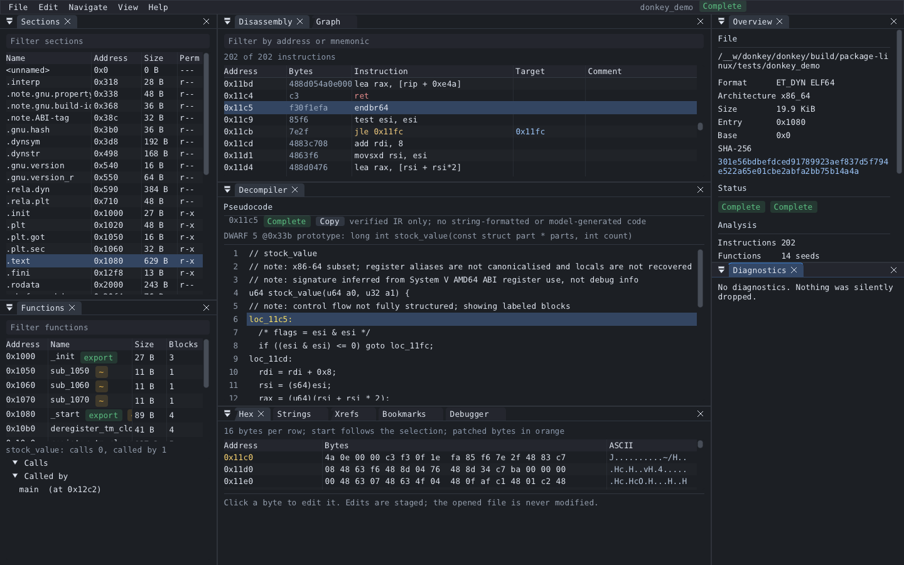
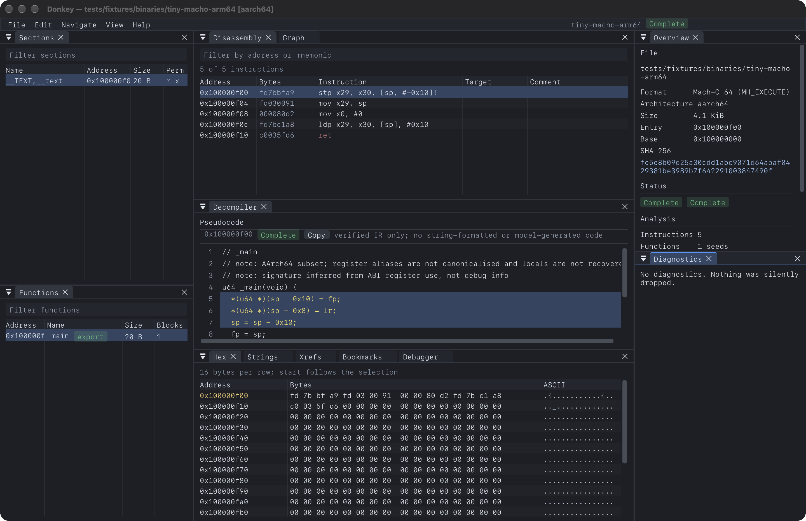
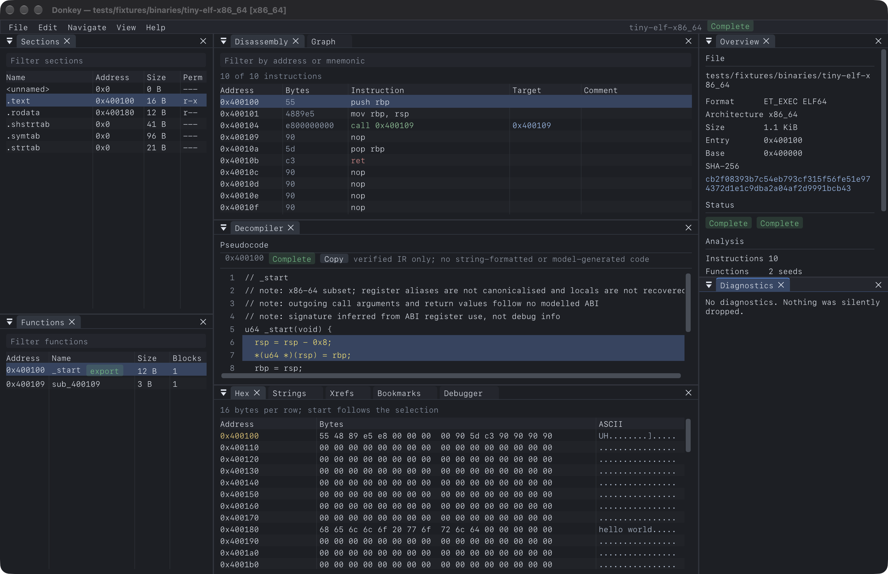
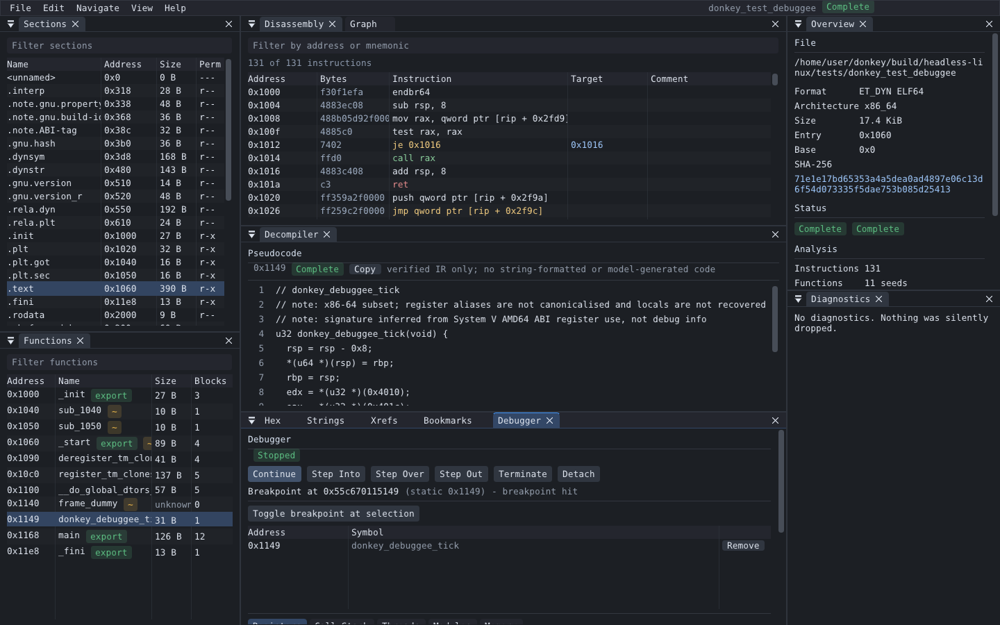
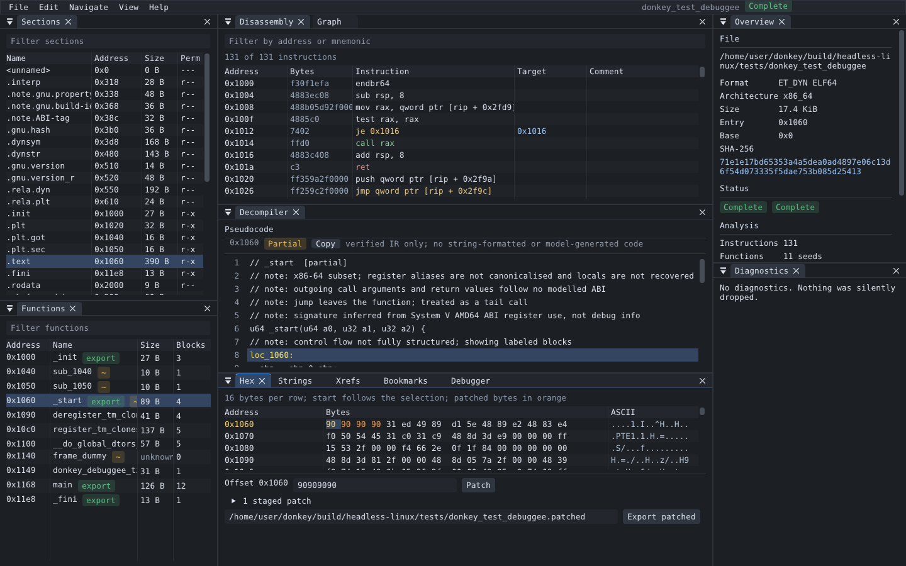

# Donkey

A free, open-source, native binary reverse-engineering suite: disassembler, analysis graphs, decompiler and debugger, written in C++20 with a Dear ImGui + SDL3 desktop shell and a headless core that also runs from the command line.

**Status: alpha.** Useful for real work on small and medium binaries, but not feature-complete and not a replacement for IDA, Ghidra or Binary Ninja. The table below is the honest state; anything not covered by the test suite should be treated as unverified. The authoritative milestone record is [docs/DESIGN.md §17.2](docs/DESIGN.md).

**Goal: parity with IDA Pro and Ghidra for everyday work.** Donkey is a long way from it. [docs/PARITY.md](docs/PARITY.md) scores 24 areas against both tools, says how each is measured, and gives the order of the work; a summary is [below](#road-to-parity-with-ida-pro-and-ghidra).

### What works

| Area | State | Notes |
|---|---|---|
| ELF / PE / Mach-O import (32/64-bit, fat Mach-O, raw) | Implemented | Bounds-checked; malformed input gives diagnostics, never crashes (fuzzed). Optional OS-process isolation (`--isolate`) on POSIX hosts. |
| Other inputs | Implemented, with limits | Relocatable objects (x86-64 and AArch64 relocations, partial), static archives (listed), Intel HEX, S-records, ELF core files and Windows minidumps (checked on a generated file, not on one Windows wrote). One image per project. |
| Disassembly (x86, x86-64, AArch64) | Implemented | Capstone 5.0.9; call/jump/return classes, xrefs, RIP-relative and ADRP data refs. |
| More instruction sets | Decode only | 32-bit ARM (A32), RISC-V (RV64GC), MIPS and PowerPC are disassembled and checked against `llvm-objdump`. They are not lifted or decompiled, and Thumb is not decoded. |
| Functions, CFG, call graph, strings, xrefs | Implemented | Bounded and deterministic. x86 and AArch64 jump tables (the GCC and Clang forms) are recovered from the bounds check and the table bytes; other indirect branches are marked `Partial`. Function boundaries can be defined or removed and persist in projects. |
| Decompiler | Partial (verified subset) | Verified-IR subset of x86-64, x86-32 and AArch64: integer code, scalar floating point on x86-64 (SSE) and AArch64, structuring, switches, ABI signatures, stack locals, conditional moves, structs behind pointer arguments. Every result marked Complete on the differential corpus is executed and compared with the compiled code at -O0/-O2/-O3 (`docs/SUPPORT_MATRIX.md`): no Complete result disagrees. A function that makes a call is Partial, because call arguments and results are not modelled yet. SIMD, varargs and every other instruction set are not implemented; they show as Partial or Unsupported, never guessed. |
| Projects (SQLite) | Implemented | Renames, comments, bookmarks, function-boundary edits, undo/redo, schema migrations, crash-safe backup/restore (fault-injection tested). |
| Patching | Implemented | Hex-view editor in the GUI and `donkey-cli patch apply`; original-byte checks, overlap rejection, export to a new file, signature-invalidation warnings. |
| Native debugger | Implemented on Linux x86-64/AArch64 (ptrace) and Windows x64 (Win32 debug API); **unsupported on macOS, FreeBSD and Windows arm64** | Launch to the real entry point, software breakpoints, step into/over/out, registers, memory read/write, pause, attach/detach, call stack, modules (including libraries loaded after launch, named from their own symbols), ASLR-aware static↔runtime mapping, explanatory permission errors. Multithreaded targets are all-stop. Hardware watchpoints on Linux x86-64 only, from `donkey-cli` and the library. No remote targets. |
| Debug information | DWARF 2-5; PDB 7.00 (C types) | Functions, prototypes, parameters, variables and types from DWARF in ELF and MinGW PE, each labelled with its provenance; user renames always win. PDB 7.00 gives C structures, enums, procedures and globals, not C++ class layouts. Separate debug files are found by build-id and debuglink, a `.dSYM` bundle by its UUID, and zlib- and zstd-compressed DWARF is read. |
| C++ | Partial | Itanium and MSVC name demangling (both partial). Itanium RTTI and vtables of ELF images, from `donkey-cli`. No exception tables, and virtual calls are not resolved. |
| Types | Partial | A type store, a bounded C declaration parser, and adding, listing and applying types from `donkey-cli`. No type libraries, and no type editing in the desktop app. |
| Interactive edits | Partial | Make code, make data and undefine (C, D, U) with undo and redo; arrays and strings as data ranges; rename, comment, bookmark, function boundaries. No types for locals and no inline data rows in the listing. |
| Scripting | Implemented | `donkey-cli serve` ([docs/RPC.md](docs/RPC.md)): JSON-RPC 2.0 with read methods, decompile and, with `--project --allow-write`, rename, comment and apply type; a batch mode; an optional Python client (`bindings/python`). Scripts run outside the desktop app. |
| Plugins | Implemented on POSIX; isolation unsupported on Windows | Versioned C ABI; untrusted plugins run in a forked worker. On Windows, untrusted inspection fails closed. |
| Desktop app | Implemented | Dear ImGui + SDL3: docked overview, sections, functions, disassembly, graph, decompiler, hex editor, strings, xrefs, bookmarks, debugger, diagnostics. Keyboard-only use (G go to, N rename, ; comment), saved layouts, DPI changes, display removal and graphics-device loss are handled and tested by scripted UI tests (`docs/UI_TESTING.md`). Falls back to a software renderer when no Vulkan/D3D12/Metal device is available. No screen-reader support. |

### Platforms

| Platform | Packages | Verified by |
|---|---|---|
| Linux x86-64 and arm64 | `.deb`, `.rpm`, `.tar.gz` (glibc ≥ 2.35) | CI (Ubuntu 22.04 build; install-and-run on Ubuntu 22.04/24.04, Debian 12, Fedora 41, Arch) and local GUI automation under Xvfb |
| macOS 11+ (Apple silicon, arm64) | `.dmg`, `.zip` | CI on macOS 15 (arm64) and earlier manual testing on macOS arm64; ad-hoc signed, not notarised |
| Windows 10/11 x64 and arm64 | `setup.exe` (NSIS), portable `.zip` | CI on Windows Server 2022 (silent install, run, uninstall) and local wine runs |
| FreeBSD 14 amd64 and arm64 | `.pkg`, `.tar.gz` | CI in a FreeBSD 14.3 VM (CLI and software-rendered GUI); no native debugger |

Not done yet: call arguments and results in the decompiler; SIMD and varargs; lifting for ARM, RISC-V, MIPS and PowerPC; library function signatures and type libraries; function discovery from unwind tables or heuristics (functions are found from the entry point, exported symbols and call targets); Go, Rust, Objective-C and Swift metadata; native debugging on macOS (Mach task ports and entitlements), FreeBSD and Windows on Arm; remote debug protocols; PDB C++ class layouts; type editing in the desktop app; resolving imports across images and multi-image project tabs; emulation, an assembler and binary diffing; screen-reader accessibility; notarised macOS builds and signed Windows installers. Files of 64 MiB and more are memory-mapped, and a 1 GiB file stays inside a 48 MiB memory budget (tested).

## Road to parity with IDA Pro and Ghidra

The goal past v1.0 is that a reverse engineer can do everyday work in Donkey without reaching for IDA Pro or Ghidra. That is a goal, not a claim. [docs/PARITY.md](docs/PARITY.md) scores each area as None, Basic, Usable or Parity; a row moves only when its measure passes in CI. On `main` today:

| Level | Areas |
|---|---|
| Usable | Executable formats; debug information; byte patching |
| Basic | Disassembly and decompilation beyond x86 and AArch64; analysis of stripped code; decompiler coverage and readability; types; C++; debugger; scripting; interactive editing; desktop views; scale |
| None | Library function identification; Go, Rust, Objective-C and Swift; emulation; diffing and version tracking; collaboration; managed code |
| Blocked on the owner | Signed releases; screen-reader accessibility |

One thing Donkey does that the other two do not: every decompiler result marked Complete on the differential corpus is executed and compared with the compiled code. Parity work is not allowed to trade that away.

The order of the work, most useful first:

1. **Every function decompiles to something useful.** Measure the decompiler on real programs, model call arguments and results, find the functions of stripped binaries, read unwind tables.
2. **Names and types appear without typing them.** Library signatures, type libraries, C++ and exception tables, Go, Rust, Objective-C and Swift.
3. **Breadth.** A processor strategy, lifting for more instruction sets, SIMD, several images in one project.
4. **Dynamic analysis.** Remote targets, the missing hosts, emulation.
5. **Workflow.** Editing, views, scripting inside the app, assembling, diffing, collaboration.

The task-level plans are in [docs/IDA_GAP_LEDGER.md](docs/IDA_GAP_LEDGER.md) (gaps G01 to G32).

## Install

Download the package for your system from the [releases page](https://github.com/palaashatri/donkey/releases) (tagged builds) or from the artifacts of the latest `package` workflow run.

- **Debian/Ubuntu:** `sudo apt install ./donkey-<version>-linux-x86_64.deb`
- **Fedora/RHEL/openSUSE:** `sudo dnf install ./donkey-<version>-linux-x86_64.rpm`
- **Other Linux:** extract the `.tar.gz` and run `bin/donkey` / `bin/donkey-cli` (or copy `bin` and `share` under `/usr/local`).
- **macOS:** open the `.dmg` and drag **Donkey.app** to Applications. The build is ad-hoc signed, so the first launch needs right-click → Open (or `xattr -dr com.apple.quarantine /Applications/Donkey.app`). The CLI is at `Donkey.app/Contents/MacOS/donkey-cli`.
- **Windows:** run the `setup.exe` (it can add `donkey-cli` to `PATH`), or unzip the portable `.zip` anywhere. SmartScreen may warn because the installer is not code-signed.
- **FreeBSD:** `sudo pkg add donkey-<version>.pkg`

The desktop app is `donkey`; the scriptable tool is `donkey-cli`. Opening a file never executes it. Only the debugger runs a program, after you confirm.

## Workbench Showcase

[docs/images/screenshots](docs/images/screenshots/README.md) has screenshots of every platform. The app captured them itself, driven by `tests/ui/screenshots.donkeyui` on a small demo program built with each platform's own compiler: the workspace, a `switch` (a jump table on x86, a lookup table with Apple Clang), a loop with its DWARF prototype where the binary carries DWARF, the component gallery and, where a native debugger exists, a breakpoint stop. Results that are not fully modelled are shown as `Partial`, as on the arm64 builds of the loop.


*Linux x86-64: the demo program's `stock_value` with its DWARF prototype above verified pseudocode.*

Older captures:

### Mach-O AArch64 Reverse Engineering Workspace

*Mach-O AArch64 binary loaded in Donkey: docked panels showing Binary Overview, Functions, Interactive Disassembly with call/jump xrefs, Control-Flow Graph with block highlights, and Decompiler pseudocode. (Captured before the native debugger existed; the Debugger panel in this image is the simulation adapter, and macOS has no native debugger yet.)*

### ELF x86-64 SSA Decompiler & Stack Frame Variable Recovery

*ELF x86-64 binary decompiled in Donkey: C-like decompilation with SSA form, dominator-verified control flow, recovered local stack variables (`local_X`), parameter inference, address-linked source mapping, synchronized hex inspection, and cross references.*

### Native debugging on Linux

*Linux x86-64 (Xvfb, Mesa lavapipe): a PIE test program launched under the ptrace debugger and stopped at a breakpoint on `donkey_debuggee_tick`; the runtime address `0x55c670115149` is mapped back through the live ASLR base to static `0x1149`, and the decompiler follows the stop.*

### Hex editing with staged patches

*Four bytes at `0x1060` replaced with `nop`s: the patch is staged on a copy (highlighted in orange), can be reverted, and is exported to a new file; the opened binary is never modified.*

- Design, architecture and milestones: [docs/DESIGN.md](docs/DESIGN.md)
- Parity scorecard and roadmap: [docs/PARITY.md](docs/PARITY.md); task plans: [docs/IDA_GAP_LEDGER.md](docs/IDA_GAP_LEDGER.md)
- Contributor and coding-agent instructions: [AGENTS.md](AGENTS.md)

## Build

Requires CMake ≥ 3.25, Ninja and a C++20 compiler (GCC 13+, Clang 16+/AppleClang, MinGW-w64 GCC 13+; GCC 12 builds but reports false warnings inside libstdc++, so use it without `DONKEY_WARNINGS_AS_ERRORS`). Dependencies are fetched with `FetchContent` at pinned commits. Building the desktop app on Linux needs the X11/Wayland development headers SDL3 uses (see `.github/workflows/ci.yml` for the exact list).

```bash
# Headless core and CLI (replace macos with linux, windows or freebsd):
cmake --preset headless-macos
cmake --build --preset headless-macos --parallel
ctest --preset headless-macos --output-on-failure

# Desktop app (dev-macos, dev-linux, dev-windows):
cmake --preset dev-linux
cmake --build --preset dev-linux --parallel
./build/dev-linux/apps/donkey/donkey tests/fixtures/binaries/tiny-elf-x86_64

# Release packages (package-linux, package-macos, package-windows, package-freebsd):
cmake --preset package-linux
cmake --build --preset package-linux --parallel
cd build/package-linux && cpack
```

`-DDONKEY_USE_SYSTEM_SQLITE=ON` links the system SQLite instead of the pinned amalgamation (for distribution packagers).

## Status

Milestones M0-M11 of [docs/DESIGN.md](docs/DESIGN.md) are implemented for the platforms and features listed above. The truth table (§17.2) gives the evidence for each and states what is not claimed. The 26 end-to-end acceptance projects are in [tests/acceptance/manifest.json](tests/acceptance/manifest.json): 23 pass, and 3 are partial with their gaps stated. Measured decompiler coverage per compiler and ISA is in [docs/SUPPORT_MATRIX.md](docs/SUPPORT_MATRIX.md), and the [user guide](docs/USER_GUIDE.md) ships in every package.

Donkey is a fast native workbench with an honest, tested decompiler subset. It is not a replacement for IDA Pro, Ghidra or Binary Ninja: their decompilers, type libraries, signature databases and processor coverage are far broader. Closing that gap is the project's goal, and [docs/PARITY.md](docs/PARITY.md) tracks it.

## Licence

MIT for Donkey's own code ([LICENSE](LICENSE)). Released binaries statically include Capstone (BSD-3-Clause and NCSA), SDL3 (zlib), Dear ImGui (MIT) and SQLite (public domain); their notices ship as [THIRD_PARTY_NOTICES](THIRD_PARTY_NOTICES).
