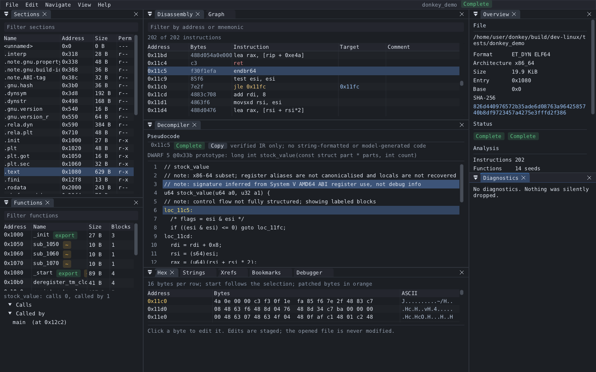
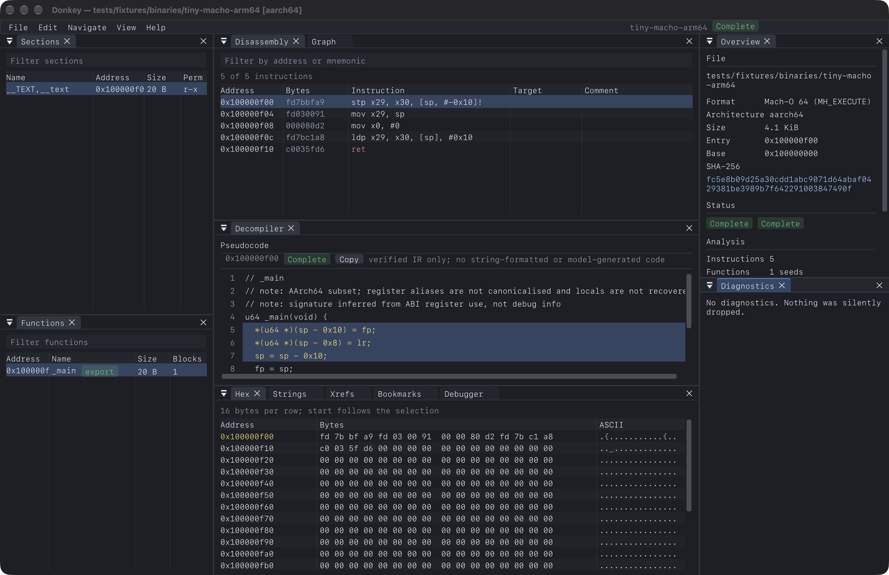
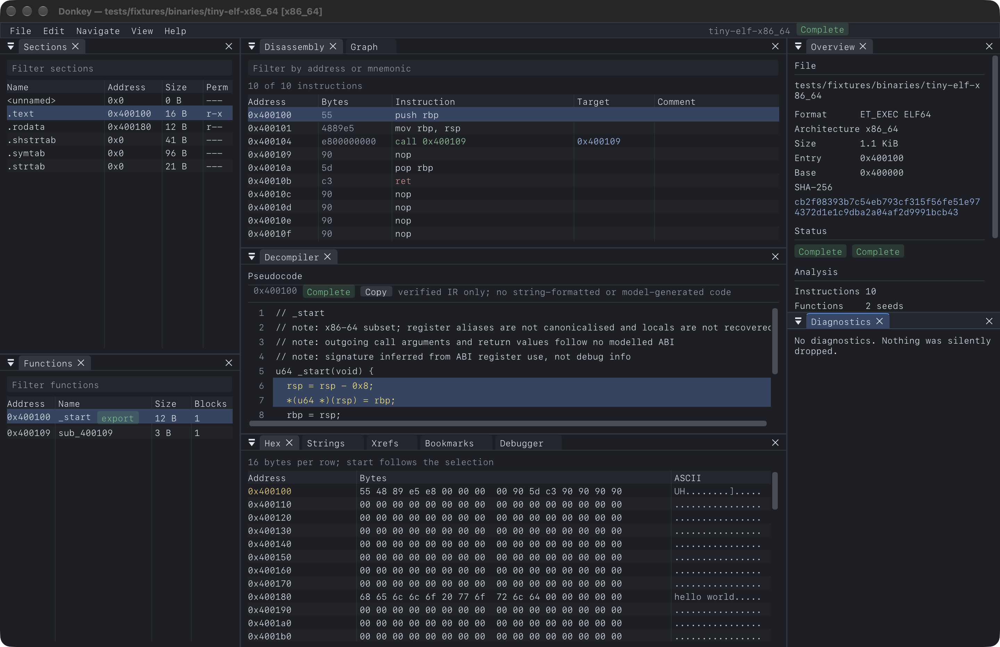
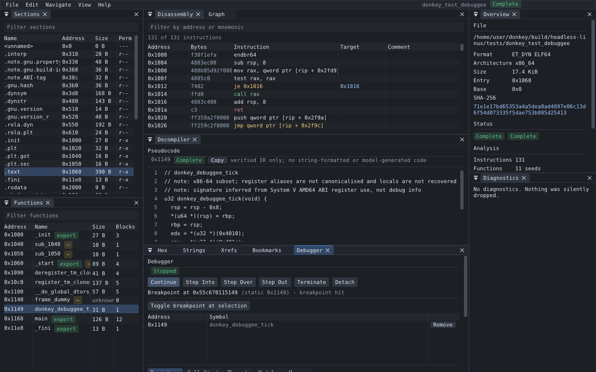
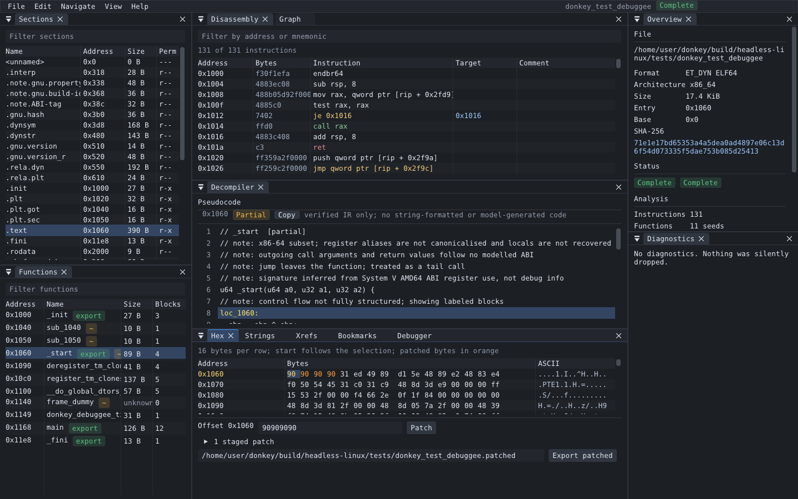

# Donkey

A planned free, open-source, native binary reverse-engineering suite: disassembler, analysis graphs, decompiler and debugger, written in C++20 with a Dear ImGui + SDL3 desktop shell and a headless core that also runs from the command line.

**Status: alpha.** Useful for real work on small and medium binaries, but not feature-complete and not a replacement for IDA, Ghidra or Binary Ninja. The table below is the honest state; anything not covered by the test suite should be treated as unverified. The authoritative milestone record is [docs/DESIGN.md §17.2](docs/DESIGN.md).

### What works

| Area | State | Notes |
|---|---|---|
| ELF / PE / Mach-O import (32/64-bit, fat Mach-O, raw) | Implemented | Bounds-checked; malformed input gives diagnostics, never crashes (fuzzed). Optional OS-process isolation (`--isolate`) on POSIX hosts. |
| Disassembly (x86, x86-64, AArch64) | Implemented | Capstone 5.0.9; call/jump/return classes, xrefs, RIP-relative and ADRP data refs. |
| Functions, CFG, call graph, strings, xrefs | Implemented | Bounded and deterministic. x86 jump tables are recovered from the bounds check and the table bytes; other indirect branches are marked `Partial`. Function boundaries can be defined or removed and persist in projects. |
| Decompiler | Partial (integer subset) | Verified-IR subset of x86-64, x86-32 and AArch64: structuring, switches, ABI signatures, stack locals, conditional moves, structs behind pointer arguments. Checked against the compiled code on a 39-function corpus at -O0/-O2/-O3 (`docs/SUPPORT_MATRIX.md`): no Complete result disagrees. Floating point, SIMD, varargs and 32-bit ARM are not implemented; they show as Partial or Unsupported, never guessed. |
| Projects (SQLite) | Implemented | Renames, comments, bookmarks, function-boundary edits, undo/redo, schema migrations, crash-safe backup/restore (fault-injection tested). |
| Patching | Implemented | Hex-view editor in the GUI and `donkey-cli patch apply`; original-byte checks, overlap rejection, export to a new file, signature-invalidation warnings. |
| Native debugger | Implemented on Linux x86-64/AArch64 (ptrace) and Windows x64 (Win32 debug API); **unsupported on macOS, FreeBSD and Windows arm64** | Launch to the real entry point, software breakpoints, step into/over/out, registers, memory read/write, pause, attach/detach, call stack, modules (including libraries loaded after launch, named from their own symbols), ASLR-aware static↔runtime mapping, explanatory permission errors. Single traced thread; no hardware breakpoints or remote targets. |
| Debug information | DWARF 2-5 | Functions, prototypes, parameters, variables and types from ELF and MinGW PE, each labelled with its provenance; user renames always win. PDB and Apple .dSYM bundles are not read. |
| Plugins | Implemented on POSIX; isolation unsupported on Windows | Versioned C ABI; untrusted plugins run in a forked worker. On Windows, untrusted inspection fails closed. |
| Desktop app | Implemented | Dear ImGui + SDL3: docked overview, sections, functions, disassembly, graph, decompiler, hex editor, strings, xrefs, bookmarks, debugger, diagnostics. Keyboard-only use (G go to, N rename, ; comment), saved layouts, DPI changes, display removal and graphics-device loss are handled and tested by scripted UI tests (`docs/UI_TESTING.md`). Falls back to a software renderer when no Vulkan/D3D12/Metal device is available. No screen-reader support. |

### Platforms

| Platform | Packages | Verified by |
|---|---|---|
| Linux x86-64 and arm64 | `.deb`, `.rpm`, `.tar.gz` (glibc ≥ 2.35) | CI (Ubuntu 22.04 build; install-and-run on Ubuntu 22.04/24.04, Debian 12, Fedora 41, Arch) and local GUI automation under Xvfb |
| macOS 11+ (Apple silicon, arm64) | `.dmg`, `.zip` | CI on macOS 15 (arm64) and earlier manual testing on macOS arm64; ad-hoc signed, not notarised |
| Windows 10/11 x64 and arm64 | `setup.exe` (NSIS), portable `.zip` | CI on Windows Server 2022 (silent install, run, uninstall) and local wine runs |
| FreeBSD 14 amd64 and arm64 | `.pkg`, `.tar.gz` | CI in a FreeBSD 14.3 VM (CLI and software-rendered GUI); no native debugger |

Not done yet: native debugging on macOS (Mach task ports and entitlements), FreeBSD and Windows on Arm; PDB and .dSYM debug information; remote debug protocols and hardware breakpoints; floating-point/SIMD decompilation and AArch64 jump tables; user-entered type edits; resolving imports across images; screen-reader accessibility; multi-image project tabs; notarised macOS builds and signed Windows installers. Files of 64 MiB and more are memory-mapped, and a 1 GiB file stays inside a 48 MiB memory budget (tested).

## Install

Download the package for your system from the [releases page](https://github.com/palaashatri/donkey/releases) (tagged builds) or from the artifacts of the latest `package` workflow run.

- **Debian/Ubuntu:** `sudo apt install ./donkey-<version>-linux-x86_64.deb`
- **Fedora/RHEL/openSUSE:** `sudo dnf install ./donkey-<version>-linux-x86_64.rpm`
- **Other Linux:** extract the `.tar.gz` and run `bin/donkey` / `bin/donkey-cli` (or copy `bin` and `share` under `/usr/local`).
- **macOS:** open the `.dmg` and drag **Donkey.app** to Applications. The build is ad-hoc signed, so the first launch needs right-click → Open (or `xattr -dr com.apple.quarantine /Applications/Donkey.app`). The CLI is at `Donkey.app/Contents/MacOS/donkey-cli`.
- **Windows:** run the `setup.exe` (it can add `donkey-cli` to `PATH`), or unzip the portable `.zip` anywhere. SmartScreen may warn because the installer is not code-signed.
- **FreeBSD:** `sudo pkg add donkey-<version>.pkg`

The desktop app is `donkey`; the scriptable tool is `donkey-cli`. Opening a file never executes it. Only the debugger runs a program, after you confirm.

## Workbench Showcase

[docs/images/screenshots](docs/images/screenshots/README.md) has screenshots of every platform. The app captured them itself, driven by `tests/ui/screenshots.donkeyui` on a small demo program built with each platform's own compiler: the workspace, a jump-table switch, a DWARF prototype, the component gallery and, where a native debugger exists, a breakpoint stop.


*Linux x86-64: the demo program's `stock_value` with its DWARF prototype beside verified pseudocode.*

Older captures:

### Mach-O AArch64 Reverse Engineering Workspace

*Mach-O AArch64 binary loaded in Donkey: docked panels showing Binary Overview, Functions, Interactive Disassembly with call/jump xrefs, Control-Flow Graph with block highlights, and Decompiler pseudocode. (Captured before the native debugger existed; the Debugger panel in this image is the simulation adapter, and macOS has no native debugger yet.)*

### ELF x86-64 SSA Decompiler & Stack Frame Variable Recovery

*ELF x86-64 binary decompiled in Donkey: C-like decompilation with SSA form, dominator-verified control flow, recovered local stack variables (`local_X`), parameter inference, address-linked source mapping, synchronized hex inspection, and cross references.*

### Native debugging on Linux

*Linux x86-64 (Xvfb, Mesa lavapipe): a PIE test program launched under the ptrace debugger and stopped at a breakpoint on `donkey_debuggee_tick`; the runtime address `0x55c670115149` is mapped back through the live ASLR base to static `0x1149`, and the decompiler follows the stop.*

### Hex editing with staged patches

*Four bytes at `0x1060` replaced with `nop`s: the patch is staged on a copy (highlighted in orange), can be reverted, and is exported to a new file; the opened binary is never modified.*

- Design, architecture and milestones: [docs/DESIGN.md](docs/DESIGN.md)
- Contributor and coding-agent instructions: [AGENTS.md](AGENTS.md)

## Build

Requires CMake ≥ 3.25, Ninja and a C++20 compiler (GCC 13+, Clang 16+/AppleClang, MinGW-w64 GCC 13+; GCC 12 builds but reports false warnings inside libstdc++, so use it without `DONKEY_WARNINGS_AS_ERRORS`). Dependencies are fetched with `FetchContent` at pinned commits. Building the desktop app on Linux needs the X11/Wayland development headers SDL3 uses (see `.github/workflows/ci.yml` for the exact list).

```bash
# Headless core and CLI (replace macos with linux, windows or freebsd):
cmake --preset headless-macos
cmake --build --preset headless-macos --parallel
ctest --preset headless-macos --output-on-failure

# Desktop app (dev-macos, dev-linux, dev-windows):
cmake --preset dev-linux
cmake --build --preset dev-linux --parallel
./build/dev-linux/apps/donkey/donkey tests/fixtures/binaries/tiny-elf-x86_64

# Release packages (package-linux, package-macos, package-windows, package-freebsd):
cmake --preset package-linux
cmake --build --preset package-linux --parallel
cd build/package-linux && cpack
```

`-DDONKEY_USE_SYSTEM_SQLITE=ON` links the system SQLite instead of the pinned amalgamation (for distribution packagers).

## Status

Milestones M0-M11 of [docs/DESIGN.md](docs/DESIGN.md) are implemented for the platforms and features listed above. The truth table (§17.2) gives the evidence for each and states what is not claimed. The 26 end-to-end acceptance projects are in [tests/acceptance/manifest.json](tests/acceptance/manifest.json): 23 pass, and 3 are partial with their gaps stated. Measured decompiler coverage per compiler and ISA is in [docs/SUPPORT_MATRIX.md](docs/SUPPORT_MATRIX.md), and the [user guide](docs/USER_GUIDE.md) ships in every package.

Donkey is a fast native workbench with an honest, tested decompiler subset. It is not a replacement for IDA Pro, Ghidra or Binary Ninja: their decompilers, type libraries, signature databases and processor coverage are far broader.

## Licence

MIT for Donkey's own code ([LICENSE](LICENSE)). Released binaries statically include Capstone (BSD-3-Clause and NCSA), SDL3 (zlib), Dear ImGui (MIT) and SQLite (public domain); their notices ship as [THIRD_PARTY_NOTICES](THIRD_PARTY_NOTICES).

## Planned SLOPOS, PARAMA and edge-device support

donkey is an original project considered for SLOPOS's **optional first-party catalog**, not required in its minimal image. Linux/SLOPOS GUI support must be demonstrated through real desktop integration; **PARAMA remains a conditional native source-port goal** after its actual process, graphics, files, ABI and toolkit dependencies exist. This is a platform roadmap, not a build/compatibility claim.

**Raspberry Pi Zero 2 W efficiency:** Architect lazy disassembly by on-demand pages/functions, bounded decoded instruction caches, streamed file reads and symbol enumeration, incremental CFG/index construction and deterministic eviction. Put heavy decompilation/debugger analyses into cancelable, memory-budgeted worker jobs, with accurate partial results and original binary unchanged. Idle should perform no full-binary scan, and analysis failure must not corrupt the project. Avoid needless editor/graphics heavyweight libraries.

See [AGENTS.md](AGENTS.md#future-sloposparama-platforms-and-raspberry-pi-zero-2-w-efficiency) for measurable acceptance and restrictions. No actual Pi Zero 2 W or PARAMA acceptance has been performed.
