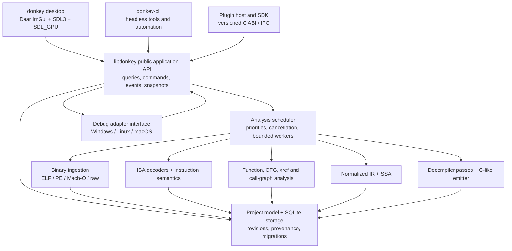
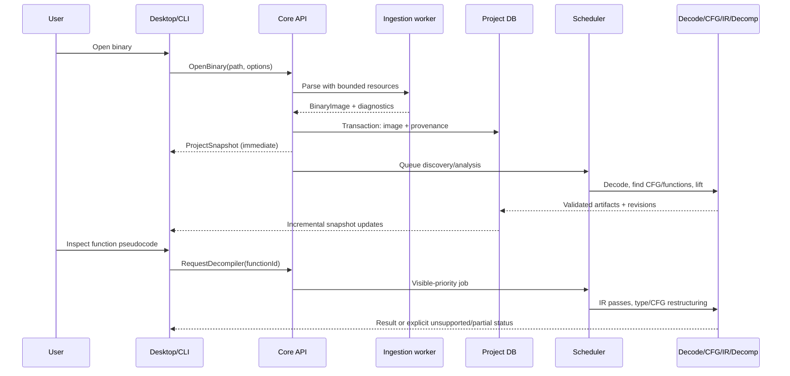
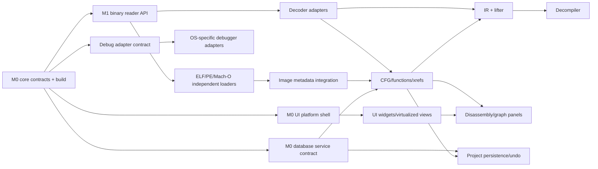

# Donkey Engineering Constitution

> **Moved from `AGENTS.md` on 2026-10-20.** This is the long-form design, milestone and acceptance reference. Day-to-day agent instructions live in the root [`AGENTS.md`](../AGENTS.md), which takes precedence where the two differ. Wherever this document says "this file" or "AGENTS.md" as the owner of truth, read "this document plus the root AGENTS.md". Section numbering is unchanged.

> **Project:** Donkey (`donkey`)  
> **Purpose:** Free, open-source, native binary reverse-engineering suite  
> **Primary implementation:** ISO C++20 throughout the product  
> **Desktop:** Dear ImGui (docking) + SDL3 + SDL_GPU  
> **Platforms:** Windows x86-64/ARM64, macOS Apple Silicon/Intel, Linux x86-64/AArch64 (support gated by CI and real testing)  
> **License goal:** MIT for Donkey-owned code, subject to a verified third-party license inventory  
> **Status at authoring:** Design contract only. No implementation, benchmark, platform support, or parity has been demonstrated.  
> **Owner of truth:** This file. Update it as part of every feature-completing change.

**Read this entire file before changing source.** This is an executable engineering contract for human developers and AI coding agents. Terms such as **MUST**, **MUST NOT**, **SHOULD**, and **MAY** express requirement strength. The milestone gates, test evidence, and current truth below override optimistic claims in PR descriptions.

---

## 0. Mission, positioning, and nonnegotiable constraints

Donkey aims to become a production-grade, fully open-source alternative to IDA Pro, Hex-Rays, Ghidra, and Binary Ninja for authorized analysis of executables, libraries, firmware, crash artifacts, and other binary code. Its differentiators are responsiveness, useful native UX, transparent analysis, scriptability, reliable headless operation, and high-quality decompilation.

**We are not building:** a thin UI wrapper around Ghidra, a rebranded hex editor, a malware-execution environment, an AI-generated pseudocode viewer, or a collection of nonfunctional menu items.

### 0.1 Product principles (priority order)

1. **Correctness and honesty first.** Wrong instruction boundaries, invented types, silent data corruption, misleading pseudocode, and fake benchmark results are release blockers.
2. **Untrusted input by default.** A file being inspected must never execute just because it is opened or analyzed. Parsing and analysis must be bounded, fuzzable, and isolated where appropriate.
3. **The headless core is the product.** The GUI, CLI, debugger adapters, and plugins consume APIs from `libdonkey`; the core must run without SDL, Dear ImGui, a display server, or a GPU.
4. **One C++ implementation stack.** All Donkey-owned application and engine code is C++20 (with minimal platform-required Objective-C++ `.mm` shims on macOS). Build tooling, CI configuration, fixtures, and externally authored scripts are exceptions, not alternate application architectures. No Qt, Electron, browser UI, JVM runtime, Rust frontend, or mandatory Python runtime.
5. **A genuine shared UI component library first.** No feature owns an independently styled button, tree, panel, table, scrollbar, modal, or shortcut implementation when a common component exists.
6. **Responsive by construction.** File I/O, analysis, symbol downloads, decompilation, database writes, and debugging requests never block the render thread.
7. **Incremental and reproducible.** Every analysis artifact has provenance, dependencies, and revision information. Edits invalidate the minimum required downstream computations.
8. **Portable and inspectable.** The same project opens consistently on supported systems; outputs are diffable or inspectable and never silently discarded.
9. **No false parity.** A feature is complete only when passing its acceptance tests on its declared platforms and fixtures.
10. **License hygiene.** No proprietary IDA/Hex-Rays/Ghidra binaries or assets, copied closed-source algorithms, unverifiable code provenance, or dependencies with incompatible redistribution requirements.

### 0.2 Scope and support tiers

- **Tier A, initial release:** PE/ELF/Mach-O; Windows/Linux/macOS hosts; x86, x86-64, AArch64; static analysis; a usable native disassembly/hex/xrefs/functions/CFG workspace; persistent projects; basic pseudocode for a clearly defined supported instruction subset; local debugging on validated hosts.
- **Tier B, later stable releases:** ARM32, RISC-V, MIPS, PowerPC and selected other ISAs; additional loaders; richer C++ recovery, DWARF/PDB symbol intelligence; advanced debugging and automation; large binary workflows.
- **Tier C, research/long-term:** advanced obfuscation handling, firmware ecosystems, multimodule lifting, JVM/.NET/Wasm analysis, collaborative projects, semantic matching, microcode-level tooling, remote agents, and optional local AI assistance.

Do not advertise Tier B/C features as supported merely because a dependency recognizes some instruction bytes. **Decoding**, **control-flow recovery**, **lifting**, **decompilation**, **debugging**, and **binary rewriting** are separate capability claims.

### 0.3 Explicitly out of scope for the first stable release

- Executing untrusted code as part of routine static analysis.
- Automatic exploit generation, payload delivery, stealth or persistence functionality.
- Guaranteed reconstruction of original source code, original variable names, or the original build environment.
- Full feature parity with every competitor, every processor, and every operating system in v1.
- Kernel debugging, hypervisor debugging, live kernel modification, anti-cheat evasion, and undocumented-protection bypass.
- A cloud requirement, telemetry requirement, user account, or proprietary service dependency.

---

## 1. Technology choices and dependency policy

### 1.1 Mandatory foundation

| Concern | Choice | Policy |
|---|---|---|
| Language | C++20 | Compiler portability; avoid nonportable language extensions in shared core |
| Build | CMake + Ninja + `CMakePresets.json` | Reproducible presets, out-of-tree builds, locked dependencies |
| Dependencies | `vcpkg` in manifest mode or CMake `FetchContent` with pinned SHAs | Pick one canonical approach at M0; no unpinned HEAD and no hidden system-only dependencies |
| UI | Dear ImGui **docking branch**, pinned commit | Explicit docking + multi-viewport tests; do not assume base `master` includes the requested behavior |
| Windowing/input | SDL3 | Native IME, clipboard, input, windows, cursors, DPI and events via SDL APIs |
| GPU | SDL_GPU with `imgui_impl_sdl3` + `imgui_impl_sdlgpu3` | Primary path; SDL_GPU selects a suitable supported system backend |
| Storage | SQLite | WAL where safe, migrations, transactions, integrity checks, backup/restore |
| Tests | GoogleTest (or an M0-approved C++ equivalent) + CTest | Unit, integration, golden, property, fuzz, GUI smoke, performance |
| Formatting/lint | clang-format, clang-tidy, compiler warnings | CI-enforced; stable pinned configuration |
| Observability | Structured logging and tracing | Local/offline by default; privacy-aware, no automatic upload |

**SDL_GPU note:** it abstracts modern native APIs such as Vulkan, Metal, and Direct3D 12; it is not a guarantee that any GPU, OS version, or driver works. M0 must probe creation, swapchain, font rendering, multiple viewports, DPI changes, device loss, and renderer fallback behavior on real target systems. If SDL_GPU proves inadequate, a renderer change requires an architecture decision; do not covertly fork UI code per OS.

**Dear ImGui note:** use the official `docking` branch and official SDL3/SDL_GPU backend files at a pinned, mutually tested revision. Enable docking and keyboard navigation; enable platform viewports only after the complete lifecycle passes each target platform's tests. Account for `ImGui_ImplSDLGPU3_PrepareDrawData(...)` before the GPU render pass as required by the pinned backend, and re-check API spelling at every dependency upgrade.

### 1.2 Candidate dependencies, not blanket approvals

| Domain | Candidate | Decision gate |
|---|---|---|
| Instruction decoder | Capstone (BSD) | Pin **stable** reviewed release/commit; avoid a pre-release without explicit acceptance |
| Alternative decoder | Zydis (x86/x64) | Optional differential decoder; evaluate licensing, maintenance, and added complexity |
| Binary loaders | Own bounded readers first; LIEF evaluated as an optional adapter | Verify exact version/license and ensure we can fuzz and audit every exposed input path |
| DWARF | LLVM DWARF or equivalent open-source library | Public API stability, size, license, cross-platform packaging |
| PDB/CodeView | LLVM-based reader or own constrained parser | No redistributable proprietary SDK requirement for baseline analysis |
| Debug symbol indexing | Internal symbol/type model | All third-party symbol formats mapped to the same normalized types |
| Assemblers/patching | Keystone/LLVM MC considered | Explicit per-ISA correctness and license review before enabling writes |
| Compression | zlib/zstd or standard alternatives | Bound decompression size and ratio; record notices |
| Testing fuzz | libFuzzer + ASan/UBSan on supported toolchains | Persistent corpora and reproducible crash minimization |

All third-party components need a pinned upstream URL, commit/version, SPDX expression, license text/notice, vulnerability review, permitted uses, and redistribution verification in the M0 dependency inventory. Prefer MIT/BSD/Apache-2.0-compatible dependencies. **Do not add GPL/AGPL code to a purported MIT-only binary without prior explicit licensing decision.** No license text should be altered or removed. Licensing decisions are engineering requirements, not legal guarantees.

### 1.3 Target compilers and build characteristics

- Windows: current supported MSVC toolset and clang-cl; x64 first, ARM64 gated separately.
- Linux: supported Clang and GCC; x86-64 first, AArch64 gated separately.
- macOS: Apple Clang; arm64 first, x86-64 gated separately; isolated Objective-C++ platform shim permitted.
- Avoid C++ compiler ABI crossing public plugin boundaries. Public native plugins use a versioned **C ABI** or versioned out-of-process RPC, while implementation remains C++.
- Exceptions are permitted internally but never cross C ABI or foreign thread boundaries. Every exported API returns explicit status and diagnostics.
- Warn on narrowing conversions, signed/unsigned misuse, UB-prone shifts, shadowing and lifetime bugs. Do not enforce warning flags that break external vendored sources.

---

## 2. System architecture

### 2.1 Component graph



The diagram shows logical dependencies, not a mandate for each box to be an independent library or thread. **No lower layer depends on Dear ImGui, SDL, GPU APIs, or GUI-owned state.** Analyzers may consume and produce versioned data through explicit APIs; they may not directly edit GUI widgets.

### 2.2 Repository layout (target)

```text
donkey/
├── AGENTS.md                       # Short agent instructions (commands, rules, workflow)
├── docs/DESIGN.md                  # This document: canonical specification, plan, truth
├── README.md                       # Short project overview and installation links only
├── LICENSE                         # Approved project license
├── THIRD_PARTY_NOTICES             # License and attribution manifest (non-Markdown OK)
├── CMakeLists.txt
├── CMakePresets.json
├── vcpkg.json                      # If vcpkg is selected in M0
├── .clang-format
├── .clang-tidy
├── .editorconfig
├── .gitignore
├── .github/workflows/              # Build, test, fuzz, packaging/security
├── cmake/                          # Toolchains and shared CMake modules
├── include/donkey/                 # Stable public C++ API surfaces
│   ├── core/                       # IDs, Result, events, cancellation, versions
│   ├── binary/                     # BinaryImage/section/address contracts
│   ├── analysis/                   # Function, xref, CFG, discovery API
│   ├── ir/                         # Typed, versioned IR contracts
│   ├── decomp/                     # Decompilation result/status API
│   ├── debug/                      # DebugSession/adapter contracts
│   ├── project/                    # Storage and migration contracts
│   └── plugin/                     # Versioned C ABI and RPC schemas
├── src/
│   ├── foundation/                 # Allocators, spans/readers, logging, IDs
│   ├── binary/                     # Bounded readers, ELF, PE, Mach-O, raw
│   ├── decode/                     # ISA-independent decoder adapters
│   ├── analysis/                   # Code/data distinction, functions, xrefs, CFG
│   ├── symbols/                    # Imports/exports, DWARF, PDB, types
│   ├── ir/                         # IR nodes, verification, lift, SSA
│   ├── decomp/                     # Pass manager, type recovery, restructuring
│   ├── debug/                      # Common debugger state machine
│   │   ├── windows/                # Debug API adapter
│   │   ├── linux/                  # ptrace adapter
│   │   └── macos/                  # Mach/LLDB adapter subject to permissions
│   ├── project/                    # SQLite, serialization, migrations, jobs
│   ├── scheduler/                  # Async orchestration, dependency graph
│   ├── plugin/                     # Trusted native plugins, isolated plugin host
│   ├── ui/
│   │   ├── shell/                  # SDL event loop, SDL_GPU, docking/layout
│   │   ├── components/             # Shared UI primitives, theme, a11y helpers
│   │   ├── workspace/              # Panels, tabs, state, command registry
│   │   ├── disassembly/            # Virtualized assembly explorer
│   │   ├── pseudocode/             # Editor-like pseudocode viewer
│   │   ├── hex/                    # Hex/ASCII viewer/editor
│   │   ├── graph/                  # CFG, call graph, minimap
│   │   ├── debugger/               # Threads, regs, stack, memory, breakpoints
│   │   └── settings/               # Preferences, themes, shortcuts
│   └── app/                         # Top-level composition and lifecycle
├── apps/
│   ├── donkey/                      # Native desktop executable entry point
│   ├── donkey-cli/                  # Headless CLI entry point
│   └── donkey-plugin-host/          # Optional out-of-process plugins
├── tests/
│   ├── unit/
│   ├── integration/
│   ├── golden/
│   ├── e2e/
│   ├── fuzz/
│   ├── performance/
│   ├── fixtures/
│   │   ├── source/                # Tiny test program source + build recipes
│   │   ├── binaries/              # Redistributable fixture binaries only
│   │   └── manifests/             # Fixture provenance/expected structure
│   └── helpers/
├── tools/                            # Dev harness, fixture generators, smoke tools
├── packaging/                        # Windows/macOS/Linux packaging and signing
└── examples/                         # Public API and plugin usage
```

The tree is a **target**, not evidence that directories already exist. M0 establishes it incrementally. There is ONE root `AGENTS.md`: no parallel `TRUTH.md`, `ROADMAP.md`, `TASKS.md`, alternative `AGENTS.md`, or competing architecture documents. Per-module `README.md` files are allowed for API usage; code-generated documentation, machine-readable fixtures, licenses, and CI configuration are allowed. Substantial architectural decisions, release truth, and milestone gates belong **here**.

### 2.3 Module dependency rules

Allowed high-level direction:

```text
foundation <- binary <- decode <- analysis <- ir <- decomp
          \       \                    \          \
           \       symbols              project      scheduler
            \______________________________________________/

core APIs <- {desktop, CLI, plugins}
debug platform adapters -> debug API -> core APIs
```

This sketch is illustrative. Enforce the exact module graph through CMake target dependencies and automated dependency checks at M0. Major boundaries:

- `foundation` depends only on C++ standard library and approved low-level libraries.
- `binary` **must not** depend on disassembly, UI, plugin system, or debugger.
- `decode` produces architectural instructions and validated metadata; it does **not** invent function boundaries.
- `analysis` never assumes every decodable byte belongs to code.
- `ir` and `decomp` depend on normalized instruction semantics, never rendered instruction strings.
- `project` is an API-owned persistence subsystem; analyzers do not issue raw SQLite SQL.
- `ui` depends on public/core application APIs only; no UI callback executes a parser or analysis algorithm synchronously.
- `plugins` have capability-filtered services rather than raw mutable pointers into application internals.

### 2.4 Ownership and communication

- **Immutable public snapshots**: UI and CLI read `ProjectSnapshot` / `AnalysisSnapshot` with stable revision identifiers.
- **Command bus**: all writes (`RenameSymbol`, `SetType`, `AddComment`, `ApplyPatch`, etc.) are validated commands; each mutation records an audit entry and triggers invalidation.
- **Event bus**: `ProjectOpened`, `AnalysisProgress`, `FunctionChanged`, `DatabaseCommitted`, `DebugStopped` are versioned and queued.
- **Task scheduler**: CPU-bound analyses run on bounded background workers, I/O in separate bounded queues. Prioritize visible function over batch work, without starving background tasks.
- **UI thread**: exclusive owner of ImGui context, SDL window state, docking model, and GPU resources. Worker threads may produce data, never call ImGui.
- **Debug state machine**: debug sessions publish snapshots; UI requests operations asynchronously. Never infer a process is stopped from stale register data.

### 2.5 Data flow: open file to pseudocode



**Time to first UI interaction must not wait for full auto-analysis.** The on-disk file may be larger than RAM; loading can be paged or mapped behind safe readers. Any parsing process boundary must be designed so a crash is reported, the GUI survives, and the project remains recoverable.

---

## 3. Foundational API and correctness contracts

### 3.1 Addresses, arithmetic, and identity

- Never confuse **file offset**, **relative virtual address (RVA)**, **virtual address (VA)**, **mapped runtime VA**, or **source location**.
- Represent a code/data location as `{ImageId, AddressSpace, uint64_t offset}`; keep preferred image base and runtime relocation mapping separate.
- Use checked conversions and checked addition/subtraction for offsets, sizes, alignments, relocation, branch targets, and section bounds.
- Binary byte order is explicit. Decode alignment and instruction width are ISA attributes, not global assumptions.
- `FunctionId`, `ImageId`, `SectionId`, `BlockId`, `SymbolId`, and `TypeId` are stable project-scoped IDs, not dereferenced pointers or UI row indexes.
- Shared API entities include `schema_version`, `origin/provenance`, `confidence` where relevant, and an analysis revision.
- A target of a branch or xref may legitimately be unknown, external, dynamic, overlapping, or unresolved. Store that state rather than fabricating a target.

### 3.2 Parse/decode status model

Core operations return typed outcomes; never coerce all non-success cases into a generic empty result.

```text
Success | Partial | Unsupported | InvalidInput | ResourceLimit |
Cancelled | PermissionDenied | CorruptProject | InternalError
```

Diagnostics contain stable machine-readable code, severity, context (image/offset/function), and safe user text. No raw unbounded exception messages or potentially secret binary strings automatically enter logs.

### 3.3 Cancellation, re-entrancy, and resource limits

- Long-running APIs accept `CancellationToken` and `ResourceBudget` (CPU/deadline, memory, bytes, task count, optional recursion depth).
- Cancellation leaves the project in a valid committed revision, not half-written state.
- Parsers validate sizes before allocation; bound recursion, string scans, section counts, relocation counts, and decompress output.
- Decoder instances are per-worker or otherwise confirmed thread-safe at the pinned version; no unsafe global mutable engine state.
- Never submit unbounded work for every address in a 64-bit sparse address space.
- No data race, deadlock, persistent leaked thread, busy-wait render loop, or UI wait on a worker future.

### 3.4 Security boundary for input

Opening a binary **must not** launch it. Features that execute a target require an explicit, separate, user-initiated debugger workflow with host OS permissions. Treat third-party formats, debug symbols, archive members, compressed sections, external symbol servers, and plugins as hostile surfaces.

Initial reader protection may use checked parsing in-process during M1; by M4 or before wide public untrusted-file support, move crash-prone or high-risk ingestion into a **real OS process boundary** with CPU/memory/time controls. A thread, C++ `try/catch`, or `std::async` does not constitute sandboxing. On Windows/macOS/Linux document which OS isolation guarantees actually exist, and degrade safely if an isolation primitive is unavailable.

---

## 4. User experience and shared component library

### 4.1 Visual and interaction principles

Donkey should feel like a carefully designed native engineering tool, not an ImGui demo with a dark theme. Use density appropriate for reverse engineering, legible typography, consistent shortcuts, predictable focus, reliable selection, and smooth large-data interaction. Do **not** copy the visual assets or trademarked UI of competitors.

Design tokens, typography, colors, animation timing, spacing, icon alignment, focus ring, contrast, and component state are central and themeable. A11y is a product requirement: keyboard operation, color-independent state, IME, Unicode, high-DPI, text scale, and screen-reader exposure must be assessed explicitly. Dear ImGui alone does not provide complete platform accessibility; an adapter or platform-native assistive integration may be required. Record such limitations instead of claiming compliance.

### 4.2 Component library before feature-specific panels

Implement and test shared components in `src/ui/components/`:

| Group | Required primitives |
|---|---|
| Navigation | app menu, command palette, searchable tree, tabs, dock host, breadcrumbs, history back/forward |
| Editors | selectable monospace text, searchable large-file lines, syntax/semantic spans, inline edit, annotations, tooltip |
| Data | virtualized table, sorted/filterable columns, outline, multi-select list, lazy tree, status/progress view |
| Controls | button, toggles, split-button, checkbox, radio, combo, numeric input, search field, command binding |
| Feedback | toast, non-modal progress, modal confirmation, error details, empty/loading/partial state, diagnostics |
| Layout | resizable panes, multi-monitor scaling, persistent workspace presets, context menu, floating panels |
| Specialized | address input, hexadecimal byte grid, register-value view, graph viewport, minimap, diff markers |

Each primitive has: input contract, stable ID behavior, theme tokens, hover/focus/disabled/error states, text scaling, keyboard contract, test coverage, and screenshot baseline (where practical). Feature teams **must** consume shared primitives; they may extend through documented extension points, not copy-paste widgets.

### 4.3 Required first-party workspace panels

- **Start / Recent Projects**: clear open/import workflow, safety warning for running targets, recent list, project settings.
- **Disassembly**: address, bytes, mnemonic, operands, labels, comments, symbols, branch navigation, xref links, bookmarks.
- **Pseudocode**: typed C-like text, clickable symbols, synchronized selections with disassembly, per-function status/provenance.
- **Hex/ASCII**: virtualized byte ranges, configurable grouping, search, selection synchronized with addresses; edits gated.
- **Functions/Segments/Imports/Exports/Symbols**: sortable searchable indexes; lazy loading.
- **Strings**: bounded extraction, encodings, xrefs, search filters; no blind allocation for malicious counts.
- **Cross-References/Call Graph/CFG**: directed navigation, nodes/edges with metadata, zoom/fit/search, keyboard access.
- **Types/Structures**: view and edit recovered/user types with attribution and conflict handling.
- **Debugger**: target/process status, threads, breakpoints, registers, stack, memory, watches, disassembly source location.
- **Task/Analysis Monitor**: state, progress units, cancellation, CPU/memory budget, diagnostics.
- **Settings/Shortcuts/Themes**: persistent and importable, backed by validated schema.
- **Logs/Diagnostics**: structured, searchable, redaction-aware and exportable on user request.

A placeholder panel is allowed only while explicitly marked `Not implemented` in both UI and truth matrix; never show fabricated pseudocode, graphs, or registers.

### 4.4 Interaction acceptance rules

1. Disassembly/hex views **virtualize** rows; no ImGui widget per instruction in a million-instruction dataset.
2. A single logical selection/caret model is shared across disassembly, hex, pseudocode, xrefs, and graph navigation; synchronizations are best-effort and never forge address mappings.
3. All long actions give progress/cancellation and do not hold input hostage.
4. Dock layouts persist and recover after unplugging a monitor or changing DPI.
5. Users can operate main navigation and data inspection with keyboard only; focus is visible.
6. Multi-viewport windows are optional until proven stable on each target; a robust single-window docking mode must always remain functional.
7. Text input handles IME, copy/paste, Unicode and invalid/unavailable glyph fallback without crashes.
8. High contrast/theme changes must not encode graph or debugger states by color alone.
9. Performance screenshots are not evidence of correctness. Every displayed data field must map to a core API source.

---

## 5. Binary formats and processor architecture

### 5.1 Binary ingestion contracts

MVP loaders: **ELF**, **PE/COFF**, **Mach-O** (thin and fat/universal), and **raw binary with explicit user-supplied CPU/endianness/base-address metadata**. Every loader must:

- Validate headers, file bounds, offsets, lengths, alignments, section overlap and integer overflow.
- Preserve raw bytes and enough normalized metadata to reconstruct import/export tables, relocations, architecture, entry points, sections, segments and mappings.
- Permit malformed-but-partially-usable inputs only with explicit diagnostics and trustworthy bounds.
- Support multiple embedded images, image rebasing, and architecture variants without address collisions.
- Preserve unknown vendor fields and opaque regions rather than pretending to understand them.
- Expose random-access bounded reading and avoid eagerly copying entire giant files.
- Record file content hash, parser version, requested options, source origin, and import timestamp in the project.

Do not automatically unpack executable packers in M1. Treat archives, self-extractors, compressed debug sections, and fat binaries as bounded nested inputs with explicit expansion budgets.

### 5.2 Decoder and semantics interface

The processor registry supplies `ArchitectureInfo`, `DecodeInstruction`, `ClassifyBranch`, `RegisterBank`, `CallingConvention`, and eventually `LiftInstruction`. It must represent:

- Instruction mode (e.g., x86 16/32/64, ARM/AArch64 variants, endianness) and feature sets.
- Instructions with authoritative byte length, raw bytes, operands, implicit register effects, optional memory effects, branch metadata and known/unknown flags.
- Invalid and truncated encodings as normal results with forward progress rules; never infinite loops.
- Indirect calls/jumps as unresolved until evidence supports a target; delays and interworking where applicable.
- Conservative distinction between executable section bytes, likely code, known code, padding, and embedded data.

Decoder support does **not** imply correct semantics lifting; capability reporting is a tuple: `{loader, decode, cfg, lifter, decompile, debug}` for each ISA/OS combination.

### 5.3 Functions, CFG, xrefs, and types

- Discovery starts from entry points, symbols, exports, relocations, exception metadata, and validated call targets, with speculative discovery tracked separately.
- Represent overlapping functions, shared tails, thunks, tail calls, jump tables, indirect edges, exceptions, and noreturn hypotheses without corrupting the project.
- Every edge has source, target (optional), kind, evidence, and confidence; both incoming and outgoing xrefs are indexed.
- User overrides are higher-priority facts than heuristics but reversible; changing a function boundary must invalidate related CFG/IR/pseudocode.
- Symbols and types have namespaces, scoped names, provenance (imported/debug/user/inferred), and conflict resolution. Never silently overwrite user edits with analyzer guesses.
- Type system must eventually model signedness, widths, pointer qualifiers, arrays, structures, unions, bitfields, function prototypes, ABI calling conventions, and platform-specific layouts.

---

## 6. Decompiler architecture (not a string formatter)

### 6.1 Pipeline and intermediate representations

```text
instruction bytes
   -> decoded instruction + explicit semantic effects
   -> low-level instruction IR (register/memory/flags semantics)
   -> normalized CFG + call-site ABI facts
   -> SSA / memory-SSA or a clearly documented memory-effect model
   -> dataflow and alias analysis
   -> constant propagation / DCE / simplification / value tracking
   -> type and calling-convention inference
   -> structured control flow recovery
   -> language-neutral high-level IR
   -> deterministic C-like pseudocode + diagnostics + source maps
```

Requirements:

- IR defines bit-vector widths, signedness rules, endianness, CPU flags, memory spaces, side effects, atomics and undefined/unknown values.
- Use explicit `unknown/unsupported` semantic nodes with reason codes; **never silently erase** unmodeled instructions.
- Lifter conformance is tested on individual instructions and short programs. Validate arithmetic, carry/borrow, comparisons, shifts, memory, calls, returns, stack effects, and condition flags.
- All IR transformations preserve semantics by construction and must run a verifier before committing output.
- Deterministic pass ordering and canonical formatting enable golden tests and stable diffs; cache keys include engine version and settings.
- Pseudocode nodes map back to source address ranges; if precision is unavailable, show `unmapped`, not a fake location.
- User-defined names/types/comments survive decompilation updates.
- A failure in one function does not poison the whole project; surface `Unsupported`, `Partial`, and pass-level diagnostics.

### 6.2 Decompiler delivery sequence

1. **D0**: IR for basic arithmetic/moves/branches/stack operations in selected x86-64 subset; verifier, lifter unit suite.
2. **D1**: Correct structured output for straight-line functions and reducible if/else/loops with primitive integers.
3. **D2**: Calls, arguments, returns, ABI-aware stack/register recovery, basic locals and pointers.
4. **D3**: Better alias analysis, switch/jump tables, structs, arrays, global variables and symbol propagation.
5. **D4**: Optimized binaries, interprocedural inference, exception models, floating point/SIMD support per ISA.
6. **D5**: Rich C++ recovery including classes/vtables/RTTI/templates-related compiled patterns (without promising original templates), architecture expansion, rewrite-quality diagnostics.

D0–D2 are reasonable staged foundations, not evidence of product parity. Differential tests compile known source fixtures with GCC/Clang/MSVC where legally available and compare recovered **behavioral/structural facts**, not only pretty pseudocode snapshots. Use interpreter/oracle or execution-equivalence tests when feasible in a controlled sandbox; never execute unknown user files in the default pipeline. Optimization levels at least `-O0`, `-O1`, `-O2`, `-O3`, and applicable LTO fixtures eventually belong to the conformance suite.

### 6.3 Acceptance of decompiled output

The engine may report `Complete` for a function only if all emitted constructs use supported semantics and verifier checks pass; otherwise mark as `Partial`, annotate unsupported regions, and retain assembly fallback. Preserve deliberate unknowns. Do not optimize a guess into a claimed fact. Measure separately: (a) functions processed, (b) functions with supported semantics, (c) verified structure/behavior, (d) rendering stability, and (e) decompilation time distribution.

---

## 7. Debugger and target-execution boundary

### 7.1 Common debugger model

Debugging is independent from disassembly. Define a versioned `DebugAdapter` with:

- `Capabilities()` for launch, attach, detach, pause, step, step-over, step-out, continue, reverse support (if any), thread enumeration, register access, memory read/write, breakpoint/watchpoint types, module loads, stop reasons, symbol resolution and target architecture.
- `DebugSession` state machine: `Disconnected -> Launching/Attaching -> Running <-> Stopped -> Terminating/Detached/Exited/Error` with explicit transitions, stop IDs and event sequence numbers.
- Operations returning asynchronous completion and errors, including permission/policy/entitlement issues.
- Separate process memory addresses from on-disk image offsets and from relocated module addresses.
- Explicit user consent before target execution, write-memory, injection-like actions, or modifications.

### 7.2 Platform adapters

- **Windows:** supported native debugging APIs; process bitness/architecture and privileges handled explicitly.
- **Linux:** `ptrace` or permitted native APIs; handle Yama restrictions, signal delivery, thread states and executable mappings without security-policy bypass.
- **macOS:** approved Mach/LLDB facilities subject to code signing, hardened runtime and entitlements. Ship meaningful errors when access is denied; do not recommend disabling host security globally.
- **Remote:** future separately versioned client/server protocol with authentication, encryption, explicit endpoint authorization and audited capabilities; not required in MVP.

Initial debug MVP supports authorized local launch, pause/continue, step, software breakpoint, registers, stack and memory read on one validated host/ISA. Cross-platform parity is individually gated later. No secret privileged helper installation; any helper must be auditable, least-privilege and clearly consented to.

---

## 8. Project storage, history, and portability

### 8.1 Project format

- SQLite database with `PRAGMA user_version` migrations; canonical storage schema version is separate from analysis engine semantic version.
- A project folder/database stores source file content hashes, import metadata, images, mapped segments, instructions where cached, functions, blocks, xrefs, names, types, comments, bookmarks, UI layout, job state summaries and provenance.
- Original binaries are **not** silently copied; make embed/reference choice explicit. If referenced externally, missing/mismatched files produce recoverable diagnostics.
- Analyzer-owned cached artifacts have recomputation version IDs; user edits use protected namespaces and event history.
- Every write is transactional. Enable WAL only when the deployment/filesystem supports it; close/checkpoint correctly. Do not open a project simultaneously for write from multiple processes without a defined locking protocol.
- Migrations must be forward-only, reversible by backup/restore if not truly reversible, and tested across supported schema versions.
- Preserve older files with a read-only fallback if the engine is newer than the project format and safe upgrade is not possible.

### 8.2 Suggested core tables (schema is evolutionary)

```text
projects, source_files, images, sections, segments, relocations,
functions, basic_blocks, edges, instructions_cache, xrefs,
symbols, types, type_members, comments, bookmarks,
analysis_artifacts, artifact_dependencies, jobs,
user_changes, migrations, workspace_layouts, settings
```

Specify primary keys, indexes, cascading behaviors, and uniqueness at M1. Avoid one SQLite row per byte. Batch writes; cap transactions to keep UI query latency bounded. Project backups and integrity checks are required before destructive schema migration.

### 8.3 Patching and edit history

Binary patching is **not** automatic or lossless by default. Require explicit edit mode, original-byte verification, preview, validation of address/file mappings, rollback, audit history and save-as output. Changing instruction bytes invalidates relevant decode/CFG/IR artifacts. `ExportPatchedBinary` must never overwrite the original by default. Repacking code-signed or checksummed artifacts may invalidate signatures; warn instead of claiming correctness.

---

## 9. Public APIs, plugins, automation, and headless workflow

### 9.1 Stable high-level API

Define thread-safe service facades with versioned models:

```text
ProjectService      open/create/save/close/snapshot/migrate
BinaryService       list images/sections/read bounded ranges/address mapping
AnalysisService     schedule/query/cancel/decode/functions/CFG/xrefs
DecompilerService  decompile/query artifact/read source map
TypeService        inspect/edit symbols, prototypes, structures
DebuggerService    launch/attach/step/memory/registers/capabilities
CommandService     validated user actions/undo/redo/audit
EventService       subscribe/replay cursor/filter
PluginService      discover/manifest/capability grants
```

Public C++ API models are explicit, documented, testable and exception-safe. Internal data structures can evolve, but persistent schemas and plugin ABIs have compatibility rules.

### 9.2 CLI command plan

The executable must be genuinely useful without a GUI or GPU. Proposed stable syntax after M0 review:

```bash
donkey-cli info ./fixture.bin --json
donkey-cli analyze ./fixture.bin --project ./fixture.donkey --arch auto
donkey-cli functions ./fixture.donkey --json
donkey-cli xrefs ./fixture.donkey --address 0x401000 --json
donkey-cli decompile ./fixture.donkey --function 0x401000 --format c
donkey-cli project verify ./fixture.donkey
```

These commands are **planned contracts**, not presently implemented tools. Machine mode stdout contains only requested output; diagnostics use stderr, exit codes are stable, and JSON fields have explicit versions. Support `--timeout`, `--max-memory`, `--threads`, `--no-network`, `--no-plugins`, and `--read-only` where applicable. No terminal escape noise in JSON mode. Network access opt-in only (e.g., symbol retrieval).

### 9.3 Plugin architecture

- **Trusted native plugins:** versioned C ABI with opaque handles, lifecycle hooks, capability negotiation, size/version headers, validated pointers and explicit ownership rules. A `.so/.dll/.dylib` loaded into the process is **not** sandboxed; label it trusted.
- **Untrusted/isolated plugins:** separate process with a versioned protocol, minimal grants, time/memory budgets and crash recovery. No raw application pointers or unrestricted database access.
- Extension points: loaders, decoders/semantics, analysis passes, renderers, format exporters, symbol providers, commands, views and debugger adapters.
- Permission model: file read, project read/write, network, debugging, patching, subprocess, and UI extensions independently granted as relevant.
- Python/MCP adapters are optional **external integrations**, not a Python or web implementation dependency for Donkey. Any agent-assisted mode is explicit opt-in, never required for normal analysis, and does not exfiltrate binaries by default.

Plugin ABI tests include invalid versions, missing symbols, permissions, cancellation, crash, slow response, multithreaded calls, unloading and backwards compatibility.

---

## 10. Security, privacy, legal, and ethical engineering

Donkey is designed for authorized analysis, education, interoperability, malware defense, incident response, and legitimate debugging. Users are responsible for obtaining appropriate rights and permissions. Product design must not silently weaken OS protections or encourage unauthorized access.

Security baseline:

1. **Never execute a file upon import.** Static analysis, preview, symbol extraction and graph generation only read data.
2. Treat binaries, malformed metadata, plugins, symbol servers, project files, archive members and update manifests as hostile.
3. Bound every parse path; fuzz parsers, expression evaluators, demanglers, decoders, decompression and plugin parsers.
4. Sandbox dangerous ingestion in an external worker as protection is implemented; document residual risks and unsupported sandbox hosts.
5. Restrict network by default. Ask before fetching external symbols; redact or avoid sending sensitive binary names/hashes unless explicit.
6. No telemetry or remote access unless explicitly enabled. Logs remain local, have retention settings, and avoid leaking target content by default.
7. Sign/notarize release artifacts when appropriate and publish checksums/provenance; never use a hidden updater.
8. Verify provenance of fixtures, fonts, icons, test binaries and dependencies; redistribute only with rights.
9. Do not copy or reverse engineer commercial competitor source/assets to implement Donkey. Study documented formats, public research, and permissively licensed code under their terms.
10. Security bugs, parser crashes, project corruption, sandbox escapes, or silent memory modifications block stable release.

Use full legal permission boundaries for debugger attach and memory modification. No global weakening of SIP, Gatekeeper, Secure Boot, antivirus, kernel security, or Linux ptrace restrictions in installation instructions.

---

## 11. Build, test, CI, and local developer experience

### 11.1 Expected build contract after M0

The following commands must work **once M0 has implemented and checked in the corresponding presets/targets**. They are not claims about the presently empty repository.

```bash
# Linux example after prerequisites are installed:
cmake --preset dev-linux
cmake --build --preset dev-linux --parallel
ctest --preset dev-linux --output-on-failure

# Headless-only build must be supported:
cmake --preset headless-linux
cmake --build --preset headless-linux --parallel
ctest --preset headless-linux --output-on-failure

# CLI smoke verification, after CLI exists:
./build/dev-linux/apps/donkey-cli/donkey-cli --version
```

Expected names: `dev-linux`, `dev-windows`, `dev-macos`, `headless-linux`, `headless-windows`, `headless-macos`, `asan-linux`, and `release-*`, with matching configure/build/test presets when applicable. Do not hardcode executable output paths in external contracts until M0 standardizes them; document in a short root README. Configure defaults to no external telemetry and no hidden SDK download. Reproducibility must be achievable from a clean clone plus documented toolchain prerequisites.

### 11.2 Required CMake target families

```text
donkey_foundation
donkey_binary
donkey_decode
donkey_analysis
donkey_ir
donkey_decomp
donkey_project
donkey_scheduler
donkey_debug
donkey_plugin
donkey_ui_components
donkey_ui_workspace
donkey_app
donkey_cli
```

Targets must declare public/private dependencies correctly. No `file(GLOB_RECURSE ...)` for source discovery where changes become silently untracked; no global include directories or linker flags that erase module boundaries. Vendor warning settings are separate from project warning policy.

### 11.3 Test pyramid

| Suite | Coverage intent | Gate |
|---|---|---|
| Unit | Checked readers, addresses, decoders, CFG, IR, storage commands, UI component models | Every PR on supported CI hosts |
| Property | Parse invariants, address round trips, CFG graph invariants, serialization stability | Every relevant PR |
| Golden | Small redacted redistributable fixtures, ABI cases, disasm/IR/pseudocode output | Every relevant PR; review expected-output changes |
| Integration | Import -> analyze -> save -> reopen -> query/decompile | Every PR after M2 |
| E2E UI | Launch, open fixture, navigate, dock, search, keyboard, close | Daily/PR where stable automation available |
| Fuzz | ELF/PE/Mach-O/raw, symbols, demangling, decoder adapters, project load, plugin RPC | Nightly continuous corpus jobs; blockers triaged |
| Sanitizers | ASan/UBSan; TSan where supported and practical | Nightly + targeted PRs |
| Performance | Latency, analysis throughput, memory, graph/scroll responsiveness, DB reopen | Baseline recorded and checked for material regressions |
| Security | Resource limits, malformed input, permissions, sandbox escape assumptions | Every change to trust boundaries |
| Packaging | Clean install/uninstall, relocatability, portable mode, license notices | Each release candidate/platform |

**No flaky-test dismissal.** Quarantine with an issue, owner, reproduction strategy and deadline; no permanent silent skips. Never mark `pass` unless the relevant command actually ran and exited successfully. Tests may use compact C++ fixture programs compiled in CI, with fixed compiler/version metadata where binary determinism matters.

### 11.4 Cross-platform CI matrix (staged)

At M0: `Linux x86-64 Debug/Release`, `Windows x86-64 Debug/Release`, `macOS arm64 Debug/Release`, plus headless builds. Expand toward `Linux AArch64`, `Windows ARM64`, `macOS x86-64` when workers/hardware exist. Unsupported combinations must be labelled `Not tested`, not silently `Supported`.

Required PR checks: configure, build, unit tests, integration tests as present, formatting, selected static analysis, dependency/notice check and changed-API compatibility review. Nightlies add fuzz, sanitizer, UI and performance checks. Release candidates require native manual smoke testing on each claimed host configuration and clean virtual machines when safe/relevant. A VM without GPU acceleration does not prove SDL_GPU compatibility on a physical machine.

### 11.5 Test fixture provenance

Each binary fixture records:

```yaml
id: pe_x64_calls_o2_001
format: PE
architecture: x86_64
compiler: clang-cl
compiler_version: pinned-in-ci
optimization: O2
source_license: MIT
source_path: tests/fixtures/source/calls.cpp
expected:
  imports: ["example-only"]
  functions_min: 2
  entrypoint_valid: true
  decompiler_status: partial-or-better
sha256: generated-and-verified-by-build
```

The manifest is an **example schema**, not a real fixture. Fixture binaries are kept small, redistributable, and verified by hash. Include corrupted/truncated fixtures and explicitly expected failures. Golden results describe observable invariants rather than unreliable guesses about original variable names.

---

## 12. Quantitative acceptance and performance contract

### 12.1 Universal correctness gates

Every finished feature MUST pass:

- Correctness tests for valid, malformed, truncated and boundary inputs.
- Repeated open/close/cancel cycles without crashes or resource leaks.
- Save/reopen where state is persistent; clear invalidation of caches after edits.
- Headless accessibility when the feature is core logic.
- Windows/Linux/macOS builds for any feature advertised as cross-platform; exceptions documented per host/ISA.
- Documentation of supported and unsupported cases, evidence links and reproduction commands.
- A real test assertion for every claimed acceptance requirement, not merely a checkbox.

### 12.2 Performance service objectives (provisional until baselined)

Benchmark on a documented **reference machine** (suggested initial baseline: 8 logical CPU threads, 16 GiB RAM, SSD, mainstream supported GPU; record exact OS/compiler/build and dependency versions). Hard performance gates begin only after M0 harness and baseline are recorded.

| Operation | Intended threshold | Benchmark notes |
|---|---|---|
| UI launch without project | p95 <= 2 s after warm start | Hardware- and OS-specific; record cold start separately |
| Window input during analysis | p95 input-to-next-frame <= 50 ms | Measured under 8-way analysis load; no render-thread blocking |
| Virtualized 1,000,000-row synthetic disassembly | p95 frame time <= 33 ms while scrolling | Data provider stub vs real analysis measured separately |
| 100 MiB binary initial metadata view | UI interactive <= 5 s | Import/parse may continue; distinguish warm/cold cache |
| Function focus -> cached disassembly | p95 <= 100 ms | Known cached function, no DB cold read |
| Cancel analysis | stop or acknowledge cancellation <= 2 s | No data corruption; noninterruptible OS waits separately documented |
| Project save/reopen | No data loss, bounded growth | Full latency benchmark set after M2 |
| Decompiler | Per-function p50/p95 and support rate published | No arbitrary numeric speed claim without corpus and machine |

These are **engineering targets, not achieved numbers**. PRs must not manufacture measurements. Document variance, warm/cold behavior, sample sizes, and significant regressions. A slow correct parser is preferable to a fast unsafe parser; performance work cannot weaken validation.

### 12.3 Release readiness

- All release-blocking tests green on every claimed platform.
- No confirmed critical/high-severity security flaw unresolved, no known reproducible project corruption.
- Installer, portable binaries and symbol/third-party notices validated.
- Backward-compatible project import or an explicit migration supported with recovery path.
- All supported features have a real demonstrable acceptance fixture and stated capability level.
- No mandatory network access, no hidden updater, no unlicensed bundled assets.
- A user can reproduce the signed artifact build/provenance to the degree the platform toolchain permits.

---

## 13. Milestones and mandatory exit criteria

Milestones are **capability gates**, not calendar promises. A milestone is not `Done` merely because its folders or classes exist. Agents can implement later-layer groundwork in parallel only when interface contracts are frozen; never mark downstream acceptance complete early.

### M0 — Foundational repository, build, design contracts

**Deliver:** compilable C++20 monorepo, `donkey-cli --version`, empty SDL3+Dear ImGui shell, project conventions, licenses/notice inventory, CI and test runner.

**Acceptance (all):**

- Clean clone configures/builds/tests on Linux x86-64, Windows x86-64 and macOS arm64 (or records explicit infrastructure blocker and labels support unverified).
- Headless mode builds and runs on each validated host without SDL/UI dependencies; dependency-graph test rejects forbidden links.
- Shell opens/closes; SDL_GPU backend initializes and renders a dockspace on all claimed hosts; fallback/unsupported GPU error explains itself.
- A basic shared button/search/table component is visibly used in a test screen; scaling and keyboard input smoke tests exist.
- One runnable GoogleTest, one CTest integration invocation, clang-format check, CI workflows, pinned dependency manifests and license notices exist.
- No warning suppression blankets project sources. All new source targets are in CMake and tested in both Debug and Release.

### M1 — UI foundation and safe binary import

**Deliver:** common UI components, workspace shell, binary access services and basic ELF/PE/Mach-O/raw import with safe metadata.

**Acceptance:**

- Open at least one tiny valid ELF, PE and Mach-O fixture on each host irrespective of originating platform; display format, architecture, mapped segments, entry point and deterministic hash.
- Truncated/overlapping/overflowed headers return deterministic errors without crash, OOM, read beyond buffer or infinite loop.
- Binary offsets and virtual addresses round-trip on validated mapped segments; overflow is rejected.
- Dock layouts, keyboard shortcuts, high-DPI resizing, theme tokens and per-panel selection work on tested hosts.
- Save/reopen a project with image metadata and user annotation exactly preserved.
- UI responsiveness and thread separation tested with intentionally slow mock import.

### M2 — Disassembly navigation vertical slice

**Deliver:** Capstone-backed x86-64 and AArch64 decode, function seeds, disassembly, hex viewer, symbols, strings, xrefs, `donkey-cli info` and `analyze`.

**Acceptance:**

- Deterministic disassembly for ELF x86-64, PE x86-64 and Mach-O AArch64 golden fixtures; lengths/targets agree with independently verified reference facts for the tested subset.
- Decode invalid/truncated instruction safely and advance or stop by documented policy; no hang.
- Navigation works among bytes, addresses, functions, xrefs, imports and strings; selection correspondence validated.
- 1,000,000-row synthetic virtualization test avoids per-row persistent ImGui objects and meets baselined UI threshold.
- Headless CLI exports versioned deterministic JSON; machine output has no UI noise.
- Database reopen gives the same functions/xrefs/comments as before closure.

### M3 — Robust analysis graph and project model

**Deliver:** CFG, call graph, more reliable function discovery, relocation handling, symbol namespaces/types foundation, reversible edits and incremental job scheduler.

**Acceptance:**

- CFG block edges validated against known branching fixtures, including conditional/unconditional, call/ret, tail-call and a bounded indirect case.
- Incorrect or uncertain edges are represented as partial/unknown, never silently resolved to fabricated addresses.
- Rename, comment, bookmark, function boundary edit survive save/reopen and undo/redo; dependent caches invalidate.
- CFG viewer supports zoom/pan/layout/search, navigating graph <-> assembly; handles 10k-node synthetic graph without render-thread hang.
- Cancellation during queued/running analysis leaves a consistent committed revision; repeated cancel/restart works.
- Scheduler honors high-priority visible-function requests and bounded worker limits; concurrency tests pass.

### M4 — Semantic lifting, IR verifier, and isolation

**Deliver:** low-level bit-precise IR, verifier, x86-64 lifter D0, reader worker isolation, typed diagnostics and code/data provenance.

**Acceptance:**

- Lifter agrees with independent specified arithmetic, flags, shifts, branches and memory cases for a documented instruction subset.
- SSA/IR validation detects type-width mismatch, invalid dominator use, bogus block targets and non-well-formed control flow.
- Unsupported instructions preserve explicit opaque effects/diagnostics; no silent dropping.
- Malformed executable that crashes isolated parser worker leaves desktop running and project recoverable; real process isolation is demonstrated on supported hosts.
- Fuzzer for format parser and IR verification runs, has stored corpus and crash minimization instructions.

### M5 — First honest decompiler

**Deliver:** D1/D2 staged C-like pseudocode for supported x86-64 subsets, verified control-flow structuring, pseudocode workspace, symbol mapping.

**Acceptance:**

- Golden fixtures covering arithmetic, if/else, nested loops, simple calls, parameters and return values produce syntactically valid C-like text with verified structural/semantic invariants.
- `donkey-cli decompile` and GUI use one engine and produce same canonical function output.
- Every pseudocode token/range with known source location navigates to assembly; unknowns are visibly marked.
- Unsupported/mis-analyzed cases report `Partial`/`Unsupported` with actionable diagnostics, not bogus `Complete`.
- Editing symbol/type/comments yields deterministic recomputation and preserved user edits; no UI freeze.

### M6 — Debugger MVP and safe process control

**Deliver:** one host/ISA end-to-end debug adapter, process state model, basic debugger panels, permission UX.

**Acceptance:**

- Launch controlled local fixture; stop at entry/breakpoint, step, inspect registers/stack/memory, continue and detach/exit; no orphaned target process.
- Target runtime address -> module mapping -> static image mapping is verified with relocated fixture.
- Permission denied, target exit, timeout, attach failure and debug-session cancellation are all graceful.
- GUI never shows stale registers as current after resume; debugger commands never block render loop.
- Attach and memory-write privileges require explicit supported capabilities/consent; no weakening of host security.

### M7 — Cross-platform debugging and advanced symbols

**Deliver:** tested adapters for Windows/Linux/macOS, PDB/DWARF enrichment, types and call stacks on supported combinations.

**Acceptance:**

- Local debugging smoke suite passes separately on each host/ISA advertised as supported.
- Missing entitlements or system debugging permission yields an explanatory error and unaffected static-analysis workflow.
- Imported DWARF/PDB names and types are provenance-labelled; type conflicts do not destroy user edits.
- Debugger/analysis address synchronization works for ASLR and dynamic module loading fixtures.

### M8 — Decompiler breadth and quality

**Deliver:** D3 and selected D4: switch recovery, structs, arrays, pointer analysis, ABI model, common optimized code patterns; AArch64 lifter/decompiler subset.

**Acceptance:**

- Publish tested per-ISA support matrix including instruction/lifter/decompiler coverage, optimizer modes and failing classes.
- Validate integer, pointer, arrays, loop variants, switch and ABI fixtures from supported compilers at O0/O2/O3.
- Regression suite includes exact expected unsupported outcomes and does not game quality by hiding failures.
- Relative to M5 baseline, publish semantic correctness and coverage improvements with corpus provenance.

### M9 — Plugins, automation, patching, and extensible analysis

**Deliver:** stable v1 plugin protocol, trusted and isolated plugin examples, API usage examples, patch preview/export and rollback, CLI scripting-friendly outputs.

**Acceptance:**

- Plugin load/unload, version negotiation, capability enforcement, crash handling and external process isolation tests pass.
- Plugin cannot mutate persistent data except through validated commands granted by capabilities.
- Hex edit and instruction patch fixture generates correct output bytes in save-as file; original stays unchanged; failed patch leaves no partial output.
- CLI automation reproduces GUI query results; no mandatory Python/web/AI runtime.

### M10 — Large-binary reliability, ergonomics, and accessibility

**Deliver:** production-performance pass; huge sparse images, large symbol tables, scalable UI virtualization, consistent keyboard behavior, advanced workspace UX.

**Acceptance:**

- 100 MiB and 1 GiB synthetic/redistributable datasets run within documented memory budgets and show clear progress; test environment recorded.
- Cross-monitor DPI, hotplug, docking persistence, GPU context/device loss, Unicode/IME, keyboard-only flows validated on claimed OS versions.
- `p50/p95/p99` responsiveness reports backed by repeatable harness; no unjustified improvements claimed.
- Fuzz corpus growth and memory-leak checks show no known severe regressions.

### M11 — Public beta hardening

**Deliver:** tested installers/portable releases, migrations, notices, user docs, recovery, error reporting without telemetry, preview/beta support matrix.

**Acceptance:**

- Fresh-install and clean-uninstall tests on all advertised platforms.
- Import/project/decompile/debug smoke projects complete without data loss or stuck UI.
- Reopening old projects from all supported prior DB schema versions either migrates correctly or fails read-only with recovery instructions.
- Published SHA-256, SBOM/license notices, exact known limitations, support matrix and reproducible build instructions.
- No confirmed release-blocking parser crash, project corruption or high-severity security bug.

### M12 — v1.0 general availability

**Deliver:** stable native release with defined Tier A claims, public API compatibility window, support policy and documented limitations.

**Acceptance:**

- All M0–M11 release-blocking criteria met for every feature claimed in v1.0.
- No false feature parity claim; exact advertised capabilities reflected by passing tests and demo corpus.
- Headless CLI and GUI work offline for ordinary static analysis.
- At least 20 independent end-to-end acceptance projects (see §14) pass on appropriate host/ISA targets, with source/provenance.
- No known major accessibility blocker without explicit release note and a tracked correction plan.
- Release signed/notarized where feasible and supportable; checksums and third-party license attributions published.

---

## 14. End-to-end acceptance projects (minimum 20)

Each project is versioned, builds or supplies a permitted fixture, has a manifest, automated assertions, and a reproducible analyst walkthrough. Pass/fail is tracked separately by host/ISA/optimization. **A mock graph or static screenshot cannot pass a project.**

| ID | Scenario | Main acceptance assertions |
|---|---|---|
| A01 | ELF x86-64 hello, O0 | Valid segments, entry, main discovery, baseline assembly |
| A02 | ELF x86-64 arithmetic, O2 | Correct operand widths, control flow, partial-or-better decompilation |
| A03 | PE x86-64 imports/exports | IAT/export symbols and xrefs land at validated addresses |
| A04 | Mach-O arm64 thin binary | Sections, entrypoint, correct AArch64 instruction boundaries |
| A05 | Mach-O universal binary | Multiple architecture slices with independent identities |
| A06 | Raw firmware blob | Explicit architecture/base handling and unknown-region labeling |
| A07 | Truncated ELF/PE/Mach-O | Controlled `InvalidInput`/`Partial`, zero crash/OOB |
| A08 | Maliciously large declared section | Resource cap, no OOM, recoverable error |
| A09 | x86-64 branch-heavy CFG | Known block/edge facts, no invented indirect targets |
| A10 | Large function index | Virtualized list, search and fast scrolling |
| A11 | Symbol rename + type correction | User edits persist and invalidate affected pseudocode |
| A12 | Database migration from older schema | Backup/restore, content preserved, integrity check |
| A13 | Transaction cancellation | Consistent revisions, no ghost rows after restart |
| A14 | Two independent binaries linked by imports | Distinct image identities and cross-image references |
| A15 | IR arithmetic/flags corpus | Verified bit-vector semantics and unsupported handling |
| A16 | If/loop decompiler corpus | Structured C-like result and source-map navigation |
| A17 | Switch/jump-table corpus | Evidence-backed targets, graceful unresolved cases |
| A18 | Local debugger launch fixture | Step/breakpoint/register/stack/exit correct on validated OS |
| A19 | ASLR-enabled debugger fixture | Runtime VA translates to correct static image region |
| A20 | Plugin bad-version/crash fixture | Explicit rejection/crash isolation and core survival |
| A21 | Hex patch + export fixture | Original unchanged; patched output hash and bytes verified |
| A22 | Multimonitor workspace fixture | Dock/save/reopen and display removal recover gracefully |
| A23 | Unicode/IME/keyboard navigation | Input and accessibility basics survive focus changes |
| A24 | 1 GiB sparse/malformed-data fixture | Bounded memory and cancellation; no eager whole-file copy |
| A25 | Architecture capability matrix | Unsupported lifter vs supported decoder accurately represented |
| A26 | Offline headless import/report | No GPU, UI, Python, account, telemetry or network required |

A01–A26 are a **planned suite**, not present binaries or completed tests. Build an initial smaller subset early, then grow it milestone by milestone. A given platform may mark a legitimately inapplicable debugger test `N/A` with justification; never convert it into a pass.

---

## 15. Multi-agent development operating system

The repository is deliberately designed for independent human/AI agents working concurrently. Throughput does not justify races, duplicate implementations, or integration debt. All agents follow the same contracts.

### 15.1 Agent roles and responsibilities

| Role | Ownership | Must not independently change |
|---|---|---|
| **Coordinator/integrator** | Milestone plan, API approvals, integration, truth updates, release gates | Fake test evidence or merge unreviewed conflicting API changes |
| Foundation agent | IDs, checked readers, errors, logging, resource budgets | UI, parser heuristics |
| Build/CI agent | Toolchain, dependencies, presets, CI, packaging | Semantic core APIs without owner review |
| UI foundation agent | SDL3/SDL_GPU shell, design tokens, shared widgets | Parsers, SQL, decoder semantics |
| Binary formats agents | ELF / PE / Mach-O / raw under mutually exclusive file ownership | Unreviewed common reader changes |
| Decode/ISA agent | Decoder adapters, capability registry, golden instruction tests | IR semantic contracts without IR owner review |
| Analysis agent | Functions, CFG, xrefs, scheduler integration | Binary file parsing internals |
| Storage agent | Schema, migrations, transactions, provenance, snapshots | Direct UI changes or hidden global state |
| IR/decompiler agent | Typed IR, lifter, SSA and transformations | UI render loop or debugger target state |
| Debugger agents | Common adapter then OS-specific backend per host | Silent privileged operations |
| Plugin/API agent | Public C ABI, process IPC, sandbox capability model | Leaking mutable core pointers |
| Verification/red-team agent | Differential tests, fuzzers, perf benchmark and security assumptions | Moving expected outputs merely to make tests green |

An agent may touch another ownership area only after obtaining an integration contract and recording the reason. The **coordinator alone** resolves conflicts in public APIs, dependency upgrades, schema migrations, and mainline integrations. In a single-repo workflow, use worktrees and topic branches, **not permanent branches for components**.

### 15.2 Suggested worktree naming

```bash
# Start from updated main and a claimed, non-overlapping issue:
git fetch origin
git worktree add ../donkey-agent-elf -b agent/elf/M1-bounded-loader origin/main
# Work and test only the assigned module and published API contracts.
# Open a focused PR back to main. Delete the branch/worktree once merged.
```

Do not delete a branch/worktree with unmerged contributions, untracked test evidence, or unresolved integration review. Do not force-push to `main`. A git branch represents a **change**, not a product subsystem. The canonical product always builds from `main`.

### 15.3 Dependency-aware work scheduling



**Concurrency rule:** Start with 4–8 genuinely independent agents while contracts are fluid. Increasing to ~15–20 agents is permitted only after a coordinator confirms sufficiently isolated ownership, pinned interfaces, available CI capacity, and integration throughput. Do not equate agent count with progress. Make tasks small enough for 1–3 reviewable PRs, with defined inputs, outputs, tests and ownership. Never assign two agents the same core files or database migration version simultaneously.

### 15.4 Frozen interfaces and change control

Before launching implementation in parallel, the coordinator publishes:

1. `Address`, `ImageId`, `Result`, `Diagnostic`, `CancellationToken`, `ResourceBudget` contracts.
2. BinaryImage/section/mapping APIs and error semantics.
3. Project snapshot/events/command APIs.
4. Decoder output and graph model.
5. Thread ownership and dispatch rules.
6. CMake target names and dependency graph.

Agents must compile against these **real checked-in headers**. Do not invent temporary duplicate headers, fake implementations or `TODO` stubs that masquerade as real features. API changes require a focused proposal: caller impact, migration, tests, and coordinator approval. Schema changes require a numbered migration allocated by the storage owner.

### 15.5 Universal agent execution protocol

Every agent MUST:

1. Read this file and current `main`; inspect actual code rather than trusting a prior summary.
2. State assigned issue/milestone, owned paths, dependent APIs, expected acceptance tests, and stop conditions.
3. Search for existing implementations before adding files or new libraries.
4. Write or update failing tests **before or alongside** the implementation; tests must exercise behavior and error paths.
5. Make minimal, modular changes; prefer a vertical slice with real data over scaffolding for an entire future subsystem.
6. Run formatter, relevant unit tests and integration tests; run the broad matrix where accessible.
7. State exact commands, test results, platform, compiler/build mode, fixture hashes and unresolved blockers in the PR.
8. Add only dependencies that pass licensing/size/security review; pin versions and include notices.
9. Mark incomplete paths explicitly, using `Unsupported`/`Partial` return values, not fictitious success.
10. Update the appropriate milestone/truth cells in this file only for **evidenced** completed work.
11. Open a focused PR and wait for integration. Agents MUST NOT self-merge conflicting public API, schema, or release changes.
12. On merge, delete stale branches/worktrees and ensure `main` remains buildable.

**Forbidden shortcuts:** hardcoded expected output keyed to fixture filename; tests that only assert non-null pointers; catching all exceptions and returning success; disabling failing tests; ignoring sanitizer reports; vendor code without provenance; source code copied from proprietary targets; blanket `NOLINT`; unbounded recursion/allocations; direct SQLite writes from the UI; modifying compiler flags to hide UB; stub pseudocode presented as complete; invented performance numbers or pretend release parity.

### 15.6 PR contract (copy this template into the PR body)

```text
Title: [M#][module] concise behavior change
Scope/owner: <paths and module>
User-visible behavior: <exact difference>
API/schema changes: <none or explicit versioned changes>
Dependencies and licenses: <none or verified list>
Acceptance criteria: <checkbox + test names>
Build/tests: <exact commands and outputs, OS, compiler, config>
Fixtures: <IDs and hashes where relevant>
Safety/negative tests: <malformed, limits, cancellation, permissions>
Performance: <measured data or not measured>
Known limitations: <specific unsupported conditions>
AGENTS.md truth updated: <section and evidence>
Integration risk/rollback: <concrete plan>
```

### 15.7 No silent takeover / task ownership

The coordinator tracks `Issue ID -> owner -> paths -> dependencies -> state -> PR -> review/test evidence`. The issue tracker (e.g., GitHub Issues) holds transient assignments; this `AGENTS.md` holds architecture and milestone truth. If an agent stalls, do not have another agent rewrite its files without reassigning ownership and rebasing against current main. Avoid a giant coordinator branch containing unfinished changes from many agents.

---

## 16. First-wave atomic implementation backlog

All items are **not started** at design authoring. Work from topological order; M0 contracts before parallel feature work.

| Task | Deliverable | Dependencies | Test/acceptance |
|---|---|---|---|
| T000 | Monorepo skeleton, CMake presets, test runner | None | Configure/build/CTest on available CI |
| T001 | Dependency lock + license inventory | T000 | NOTICE verification rejects unknown dep |
| T002 | `foundation` Result/Diagnostic/IDs | T000 | Unit tests incl. overflow/errors |
| T003 | Checked binary reader + address mappings | T002 | Property tests: bounds/VA-offset round trips |
| T004 | UI platform shell using SDL3/SDL_GPU | T000,T001 | Native window/docking/GPU error smoke |
| T005 | Theme tokens, shared input/button/table | T004 | UI behavioral + screenshot smoke |
| T006 | Core event bus, scheduler/cancellation | T002 | Deterministic cancellation/race tests |
| T007 | SQLite project schema v1 + migration harness | T002 | Transaction, reopen, integrity test |
| T008 | ELF reader | T003 | ELF32/64/endian and malformed fixtures |
| T009 | PE/COFF reader | T003 | PE32/PE32+/imports + bad offsets |
| T010 | Mach-O thin/fat reader | T003 | Two slices + bounds/bad headers |
| T011 | Raw image metadata/import service | T003 | Explicit ISA/base requirement + project hash |
| T012 | Binary service + project import flow | T007,T008–T011 | CLI inspect + save/reopen |
| T013 | Decoder registry + Capstone adapter | T002,T003,T001 | x86-64/AArch64 instruction golden tests |
| T014 | UI virtual list + large text selection | T005 | 1M synthetic rows, keyboard navigation |
| T015 | Disassembly / hex view backed by real API | T012,T013,T014 | Known file browsing + address synchronization |
| T016 | Function seed/CFG/xref service | T012,T013,T006 | Known branches and negative edges |
| T017 | Persisted analysis artifacts/invalidation | T007,T016 | Cancel, edit, reopen, cache rejection |
| T018 | Headless CLI info/analyze/functions | T012,T016 | JSON schema + no UI linkage |
| T019 | IR node model and verifier | T002,T013 | Well-formed/invalid IR cases |
| T020 | x86-64 D0 lifter | T019 | Small instruction semantics corpus |
| T021 | CFG/pseudocode panel framework | T005,T016 | Navigation and honest unsupported state |
| T022 | Debug state machine/API and fake adapter | T002,T006 | Transition & async error tests |
| T023 | Fuzz harness for reader/loaders | T003,T008–T011 | Instrumented fuzz smoke in CI |
| T024 | Build provenance + release artifact checks | T001,T000 | SBOM/notices/checksums match artifact |

**First deliverable to merge:** T000 + T001 + T002 + T004 as small verified PRs, followed by T003/T005/T006/T007 in independent worktrees. Avoid assigning full decompiler or debugger implementations before core IDs, results, addresses, and scheduler contracts are stable.

---

## 17. Verification rubric, truth table, and progress reporting

### 17.1 Truth statuses

Only these statuses are permitted:

- `NOT_STARTED`: no accepted implementation.
- `IN_PROGRESS`: implementation exists or PR open; not all acceptance criteria pass.
- `BLOCKED`: external dependency, missing permission/hardware, or prerequisite unresolved; record cause.
- `VERIFIED`: all declared criteria passed with evidence on the declared platform matrix.
- `REGRESSED`: previously verified behavior now fails; highest-priority repair.
- `N/A`: test legitimately not applicable; record rationale, never count as pass.

No freehand `100%`, `production ready`, or `feature parity` without a test-grounded scope. Subsystem score is **not** the average of impressions. The authoritative metric is `passed required criteria / applicable required criteria`, together with the coverage matrix and critical blockers; unimplemented criteria count as failures, not N/A.

### 17.2 Current truth at authoring (2026-10-13)

**Nothing has been verified.** This design does not imply code, CI, benchmarks, binaries, builds or tests exist.

| Milestone | State | Evidence | Blocker/next action |
|---|---|---|---|
| M0 Foundation | NOT_STARTED | None | Implement T000–T004, obtain real CI results |
| M1 Import/UI | NOT_STARTED | None | M0 contracts and common UI |
| M2 Disassembly | NOT_STARTED | None | Loaders + decoder + project |
| M3 Analysis graphs | NOT_STARTED | None | M2 foundations |
| M4 IR/isolation | NOT_STARTED | None | M3 graph + decoder semantics |
| M5 Decompiler | NOT_STARTED | None | Verified lifter and IR |
| M6 Debugger MVP | NOT_STARTED | None | Debug API + one platform adapter |
| M7 Cross-platform debugger | NOT_STARTED | None | M6 and native CI hardware |
| M8 Decompiler breadth | NOT_STARTED | None | M5 + multi-ISA lifter work |
| M9 Plugin/patching | NOT_STARTED | None | API and storage stability |
| M10 Performance/a11y | NOT_STARTED | None | End-to-end flows and harness |
| M11 Beta | NOT_STARTED | None | Full platform/integration verification |
| M12 v1.0 | NOT_STARTED | None | All advertised Tier A release gates |

### 17.3 Evidence record format

Whenever a state becomes `VERIFIED`, append a concise evidence record under the corresponding milestone row or an embedded milestone note:

```text
Milestone: M2
Commit: <full SHA>
Environment: <OS/version, architecture, compiler/version, Debug/Release>
Commands: <literal build and test invocation>
Results: <pass counts, fixture IDs/hashes, relevant benchmark sample>
Caveats: <known limitations, N/A rationale>
Reviewed by: <reviewer or agent and integration approval>
```

Do not replace historical failures with a success-only narrative. Keep an issue/PR link to any regression, and include the fix commit and rerun evidence. Do not clutter this file with raw CI logs; link to reproducible artifacts or exact commands.

### 17.4 Source-of-truth maintenance

- Root `AGENTS.md`: mission, decisions, architecture, milestone gates, release truth, agent rules.
- Root `README.md`: concise intro, screenshots **of real software only**, build usage, links to this file.
- Module READMEs: narrow API-specific usage. Never maintain a duplicate roadmap or architecture there.
- Source: documentation comments of invariants and non-obvious algorithms.
- CI/test artifacts: actual measured evidence and generated reports.
- GitHub Issues/PRs: granular active tasks and discussion, not substitutes for design/acceptance contracts.

Any accepted PR that changes a milestone requirement or supported capability must update this file **in the same PR**. Deleting superseded planning markdowns requires moving their still-valid content here and preserving relevant provenance before deletion.

---

## 18. Definition of Done and review gates

### 18.1 Atomic task Done

An atomic task is `Done` only when all apply:

- Real implementation uses published interfaces; no misleading stubs.
- Behavior and negative tests exist, pass, and assert meaningful invariants.
- Code formatted; relevant compiler warnings and sanitizers addressed.
- Thread safety, memory bounds, cancellation, and failure paths reviewed.
- Cross-platform implications assessed; no incompatible dependency sneaked in.
- Real fixture or user-visible demonstration available where applicable.
- Build/test commands and environment listed in PR; failure/unsupported cases disclosed.
- Merged to main, mainline CI green, obsolete branch/worktree removed.
- AGENTS truth updated if milestone or API support changes.

### 18.2 Subsystem Done

A subsystem is `VERIFIED` only when the corresponding milestone acceptance tests pass on the claimed platform/ISA matrix, public API usage is tested, persistence behavior is covered if relevant, the malformed-input suite is green, performance behavior is documented, and UX does not block core tasks. Compiling alone is insufficient.

### 18.3 v1 product Done

A user can install Donkey, import a supported binary safely, browse correct disassembly and references, save/reopen annotations, view only evidence-supported decompilation, use the debugger within its explicitly supported permission/platform envelope, run the core headlessly, and recover gracefully from malformed files/errors. Release artifacts, source, notices, provenance and tests are public and reproducible as documented.

---

## 19. Repository policy, architecture decisions, and prohibited drift

### 19.1 Decisions locked unless changed via reviewed ADR in this file

| ID | Decision | Rationale |
|---|---|---|
| D001 | Native C++20 throughout | One toolchain and tight control of systems-facing work |
| D002 | Dear ImGui docking + SDL3 + SDL_GPU | Flexible native GPU UI without Qt or embedded web stack |
| D003 | Headless analysis core | Testable, scriptable and platform-independent functionality |
| D004 | Shared design system before feature panels | Consistency, maintainability and controlled UI quality |
| D005 | Capstone via interface, not hard-wired deep in core | Replaceable decoding and testable behavior |
| D006 | Own versioned IR and decompiler pipeline | Necessary for architecture-independent semantics and testable reasoning |
| D007 | SQLite with revisions/provenance and commands | Durable project model and user-edit integrity |
| D008 | Plugin v1 uses C ABI/IPC | Avoid unstable public C++ ABI and isolate untrusted extensions |
| D009 | Single canonical AGENTS.md | Prevent contradictory roadmaps and fictitious progress |
| D010 | MIT as target, subject to complete license review | Permissive goal without unverified promises |

Change process: open a focused PR section `Architecture Decision Change: D###`, describe need, at least two alternatives, API/migration impact, test/CI impact, security/license impact, and rollback. Coordinator reviews; update decision and all affected acceptance gates **before** implementation drift.

### 19.2 Disallowed architecture moves

- Replacing Dear ImGui with Qt, Electron, browser app, Rust/GPUI or Slint without an approved new architectural decision.
- Making GUI state authoritative for symbols/functions/annotations.
- Calling Capstone directly from UI panels or tying public API to a decoder-specific structure.
- Using a string tokenizer as the primary decompiler IR.
- Treating `catch (...)` / thread isolation as a crash sandbox.
- Hard-coding local absolute build paths, developer home directories, secret tokens or SDK versions.
- Forking vendor libraries unless a demonstrated fix and maintenance plan exists.
- Shipping AI-generated source transformations without compiler/semantic validation and human-readable diagnostics.
- Inserting opaque binary blobs or proprietary decompiler components in an otherwise open-source release.
- Running unfamiliar user binaries for the purpose of static analysis.

---

## 20. Suggested first coordinator prompt

> You are the Donkey integration coordinator. Read `/AGENTS.md` entirely. Inspect the repository and establish what **actually exists**, without assuming any milestones are done. Implement only M0 in independently reviewable atomic slices: C++20 CMake scaffold, pinned dependency/license inventory, foundational result/ID contracts and tests, headless CLI `--version`, SDL3 + SDL_GPU + Dear ImGui docking smoke application, CI on the available real platforms, and an acceptance evidence record. Publish minimal checked-in public contracts before spawning other agents. Use separate worktrees for nonoverlapping tasks; never claim tests you have not run. Do not start a decompiler or a full set of UI mock panels as a substitute for the foundation. Make main compile after every integration. Update the truth table with verified evidence and leave unsupported platforms explicitly unverified.

### M0 coordinator completion checklist

- [ ] `cmake --preset ...` configures and builds cleanly on all claimed platforms.
- [ ] Native shell renders via pinned Dear ImGui docking + SDL3/SDL_GPU without Qt.
- [ ] Headless CLI works without display/GPU/runtime UI dependency.
- [ ] Foundational API headers are real, compiling, and unit-tested.
- [ ] Formatter/linter/CTest/CI are implemented and pass on claimed hosts.
- [ ] Dependency versions and redistribution notices are recorded.
- [ ] Fresh-clone build instructions verified by a second clean environment.
- [ ] Truth table and acceptance records updated with honest evidence.

---

## 21. Upstream references to re-check before dependency upgrades

These references document **candidate technology**, not automatic approvals. Pin exact revisions in the repository once M0 starts.

- Dear ImGui: https://github.com/ocornut/imgui ; docking: https://github.com/ocornut/imgui/tree/docking
- Dear ImGui backend docs: https://github.com/ocornut/imgui/blob/master/docs/BACKENDS.md
- SDL3 + SDL_GPU Dear ImGui example: https://github.com/ocornut/imgui/tree/master/examples/example_sdl3_sdlgpu3
- SDL3 / GPU API: https://github.com/libsdl-org/SDL ; https://wiki.libsdl.org/SDL3/CategoryGPU
- Capstone: https://github.com/capstone-engine/capstone
- Zydis: https://github.com/zyantific/zydis
- LIEF: https://github.com/lief-project/LIEF
- LLVM project: https://github.com/llvm/llvm-project
- SQLite: https://www.sqlite.org/
- CMake presets: https://cmake.org/cmake/help/latest/manual/cmake-presets.7.html
- GoogleTest: https://github.com/google/googletest

---

**Final rule:** Donkey earns credibility with correct analysis, transparent limitations, useful native interactions, excellent tests, and reliable releases. Do not trade any of these for demos, task-count inflation, or unverified claims of feature parity.

## Future SLOPOS, PARAMA and Raspberry Pi Zero 2 W portability direction

This is a **proposed later portability/efficiency track, not implementation or M0 acceptance**. Linux/SLOPOS integration means a verified Dear ImGui/SDL3 desktop app with native file associations, scoped debugger permissions, keyboard/clipboard and packaging. PARAMA is a **distinct native source-port** requiring an actual C++ runtime, SDL3/SURYA display/input backend, files/processes/threads and capability-restricted debugging; no Linux ELF, GDB or debugger port is implied. On the real 512 MB Pi Zero 2 W, prioritize lazy disassembly, memory-mapped/streaming file access where safe, function/page-on-demand xrefs, incremental capped caches, cancellable decompiler jobs and bounded native memory. Test a real small ELF/PE corpus with exact architecture, crash and malformed-input cases; log CPU, peak RSS/PSS, UI input p95, allocation ceilings and recovery. Do not load every binary or debug index at startup or hide out-of-budget failures. Preserve the existing C++20/Dear ImGui/SDL3 design and release gates. Project remains **design-only**.
