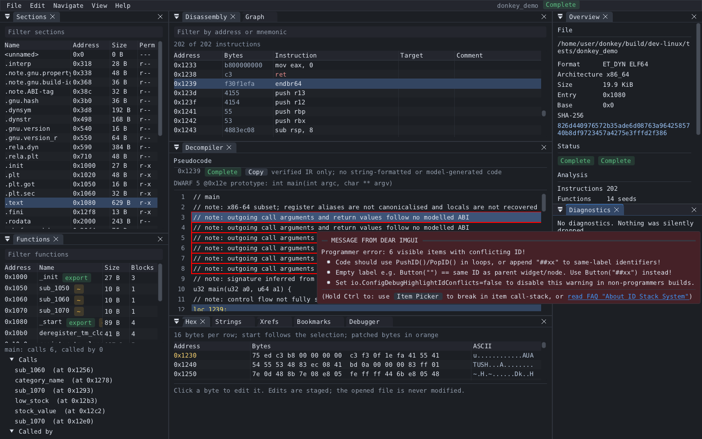
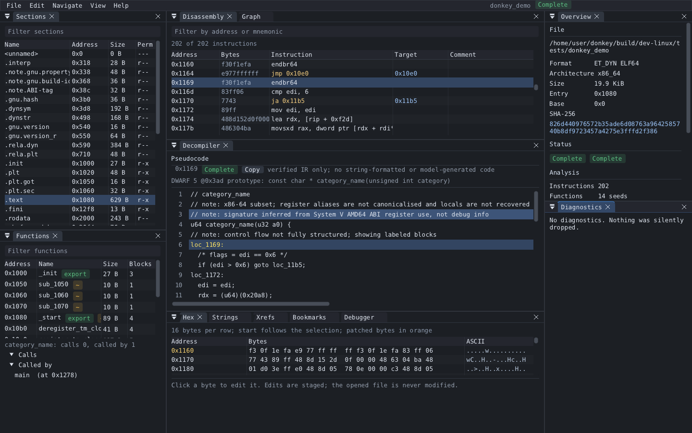
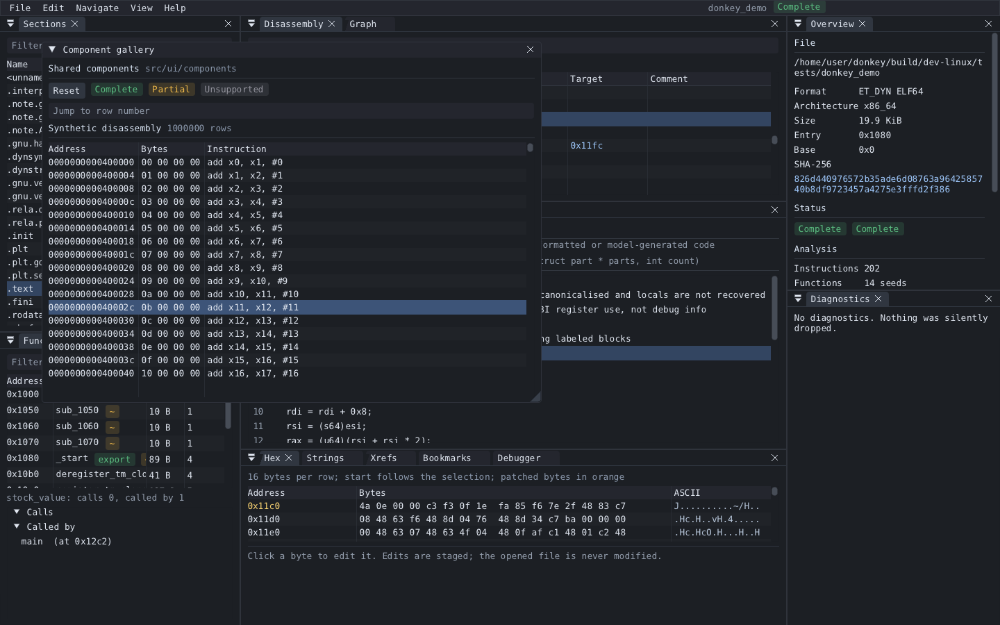
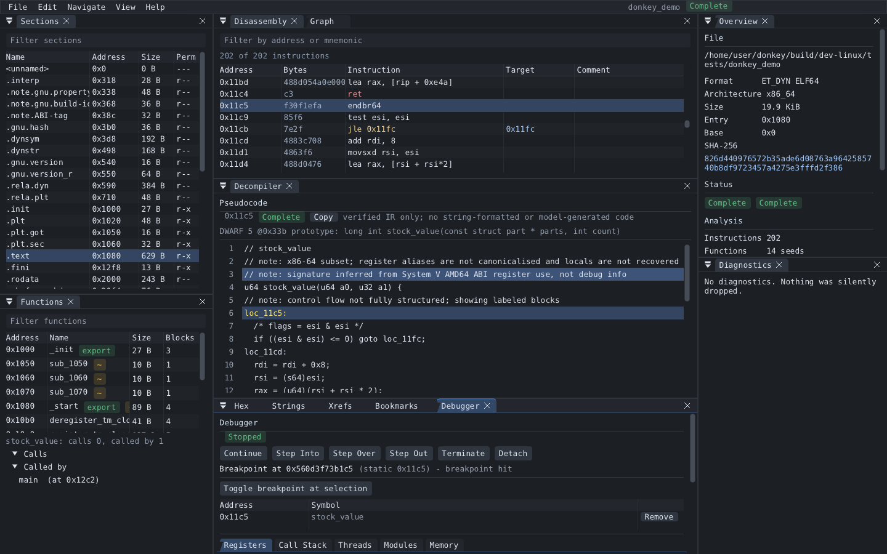

# Screenshots

Captured locally under Xvfb (commit d88f61c642f4) from the
`ui.screenshots` test: `tests/ui/screenshots.donkeyui` drives the real application
on `tests/fixtures/demo/demo.c`, built on each platform with its own compiler, using
the software renderer. Nothing here is edited by hand.

## linux-x86_64

*Workspace on the demo program: sections, functions, disassembly, pseudocode, hex view, overview*

*A switch compiled to a jump table, recovered from the bounds check and the table bytes*

*A loop over a struct array, with the DWARF prototype shown beside the pseudocode*

*Shared UI components and the 1,000,000-row virtualised table*

*The native debugger stopped at a breakpoint (Linux and Windows only)*
